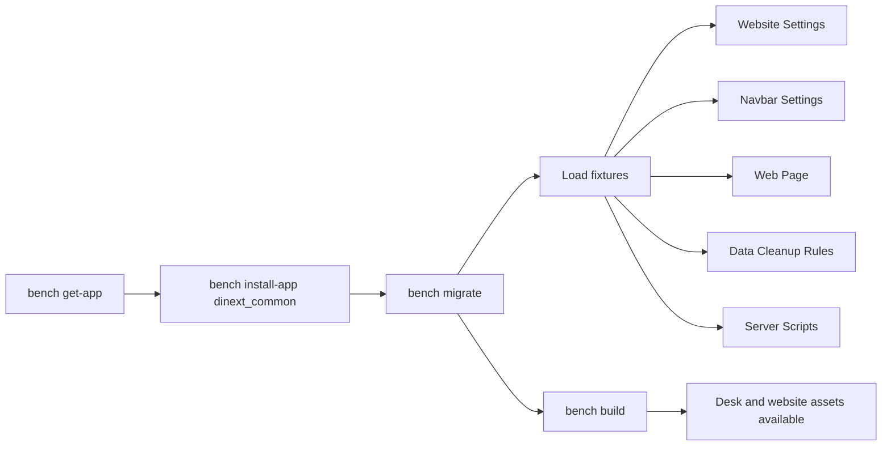
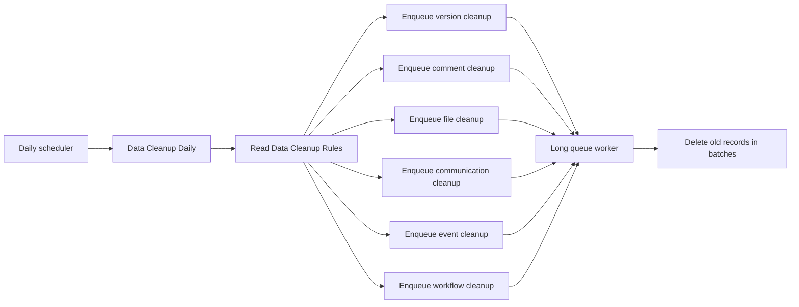

# Dinext Common

## Overview

Dinext Common is a shared Frappe app for the Administrator. It centralizes cross-project branding, website defaults, reusable Desk behavior, bundled frontend libraries, and a configurable data-cleanup subsystem that can be installed on multiple sites together with other Dinext or ERPNext apps.

In practice, this app does four things:

- applies common site configuration through fixtures such as `Website Settings`, `Navbar Settings`, `Web Page`, `Data Cleanup Rules`, and `Server Script`
- injects shared Desk assets from `hooks.py`
- provides a standard website theme and Dinext branding assets
- ships reusable JS/CSS libraries that other apps can load on demand

## Features

- Shared Dinext branding for Desk and website via `app_logo_url`, `app_icon`, and `website_context` in `dinext_common/hooks.py`
- Fixture-driven site setup for `Website Settings`, `Navbar Settings`, `Data Cleanup Rules`, Dinext homepage content, and enabled `Server Script` records from the `Dinext Common` module
- Global Desk enhancements loaded through `app_include_js`:
  - `breadcrumbs_update.js`
  - `listview_resize.js`
  - `dinext-desk.js`
  - `dashboard_filters_fix.js`
- Project-specific `sticky-datatable.js` loaded through `doctype_js` for the `Project` DocType
- Standard `Dinext Theme` website theme in `dinext_common/dinext_common/website_theme/dinext_theme/`
- Bundled frontend libraries:
  - `frappe-datatable.min.js`
  - `hyperlist.js`
  - `frappe-gantt.umd.js`
  - `frappe-gantt.css`
  - `echarts.min.js`
- Configurable daily data cleanup based on a single `Data Cleanup Rules` document and six cleanup rule tables:
  - `Version Cleanup Rule`
  - `Comment Cleanup Rule`
  - `File Cleanup Rule`
  - `Communication Cleanup Rule`
  - `Event Cleanup Rule`
  - `Workflow Cleanup Rule`

## Installation

Install the app with Bench:

```bash
cd $PATH_TO_YOUR_BENCH
bench get-app $URL_OF_THIS_REPO --branch develop
bench --site your-site.local install-app dinext_common
```

After installation or upgrade, run migration and rebuild assets so fixtures and Desk assets are applied:

```bash
bench --site your-site.local migrate
bench build --app dinext_common
```

If your deployment does not already contain Dinext branding assets, make sure these files exist under `dinext_common/public/images/` before building assets:

- `DI_SQ_NBG.png`
- `DINEXT_2.png`
- `DINEXT_FAVICON.ico`

## Usage

### Branding and shared UI

Once the app is installed and migrated:

- the Desk uses the Dinext app logo and favicon from `hooks.py`
- the website uses the Dinext splash image and the `Dinext Theme`
- the homepage route is provided through the `Web Page` fixture with route `homepage`
- the navbar Help menu exposes the documentation link `https://docs.dinext.ru`

### Desk scripts

The app injects shared behavior into all Desk sessions:

- `breadcrumbs_update.js` keeps workspace context in breadcrumbs and supports copying the last crumb
- `listview_resize.js` stores list-column widths in `localStorage`
- `dinext-desk.js` customizes the About dialog and shows installed app versions
- `dashboard_filters_fix.js` improves dynamic dashboard filtering for `_assign` and `_liked_by`

For the `Project` DocType, `sticky-datatable.js` loads a virtualized sticky datatable backed by bundled `frappe-datatable.min.js` and `hyperlist.js`.

### Data cleanup

The data cleanup subsystem is configured through the single `Data Cleanup Rules` document. Each child table defines whether cleanup is enabled, how many days of history to keep, and type-specific filters.

Available rule types:

- `Version Cleanup Rule`: filters by age and optional reference DocType
- `Comment Cleanup Rule`: filters by age, comment type, and optional reference DocType
- `File Cleanup Rule`: filters by age, file type, visibility, folder, size, attached DocType, and attached field
- `Communication Cleanup Rule`: filters by age, communication type, medium, and optional reference DocType
- `Event Cleanup Rule`: filters by age, event category, event type, and status
- `Workflow Cleanup Rule`: filters by age, optional reference DocType, and workflow status

The app also installs these enabled Server Scripts from fixtures:

- `Data Cleanup Daily` as a daily `Scheduler Event`
- `Data Cleanup Version` as API method `dinext_common_data_cleanup_version`
- `Data Cleanup Comment` as API method `dinext_common_data_cleanup_comment`
- `Data Cleanup File` as API method `dinext_common_data_cleanup_file`
- `Data Cleanup Communication` as API method `dinext_common_data_cleanup_communication`
- `Data Cleanup Event` as API method `dinext_common_data_cleanup_event`
- `Data Cleanup Workflow` as API method `dinext_common_data_cleanup_workflow`

`Data Cleanup Daily` reads the current `Data Cleanup Rules` document and enqueues one long-running cleanup job per enabled rule category. Each cleanup script then deletes matching records in batches and commits periodically.

### Loading bundled libraries from other apps

Only the libraries needed by Dinext Common itself are loaded automatically. For optional libraries, prefer lazy loading with `frappe.require()` from the consuming app:

```javascript
frappe.require(
	[
		"/assets/dinext_common/js/frappe-gantt.umd.js",
		"/assets/dinext_common/css/frappe-gantt.css",
	],
	function () {
		// Use window.Gantt here.
	}
);
```

```javascript
frappe.require(["/assets/dinext_common/js/echarts.min.js"], function () {
	// Use window.echarts here.
});
```

## Technologies

- Python 3.10+
- Frappe
- JavaScript for Desk customizations
- CSS and SCSS for shared styling and website theme assets
- Flit build backend via `pyproject.toml`
- Pre-commit tooling:
  - `ruff`
  - `eslint`
  - `prettier`
  - `pre-commit-hooks`

## Configuration

The main configuration lives in `dinext_common/hooks.py`.

Key hooks and settings:

- `app_logo_url = "/assets/dinext_common/images/DI_SQ_NBG.png"`
- `app_icon = "/assets/dinext_common/images/DINEXT_FAVICON.ico"`
- `website_context` sets the public favicon and splash image
- `app_include_css = "/assets/dinext_common/css/common.css"`
- `app_include_js` loads shared Desk scripts globally
- `doctype_js = {"Project": "public/js/sticky-datatable.js"}`

Fixtures exported by the app:

- `Website Settings`
- `Navbar Settings`
- `Data Cleanup Rules`
- `Web Page` records filtered to module `Dinext Common`
- `Server Script` records filtered to module `Dinext Common` and `disabled = 0`

Relevant fixture behavior:

- `Website Settings` sets the public app name to `Dinext`, points `home_page` to `homepage`, disables signup, sets a branded banner image, and references `Dinext Theme`
- `Navbar Settings` sets the app logo and injects custom menu items such as `Documentation`, `About`, and `Мои замещения`
- `Web Page` publishes a dynamic homepage at route `homepage`
- `Data Cleanup Rules` ships with default retention rules, including 90-day defaults for version, communication, event, file, and workflow cleanup, plus 45-day specialized comment cleanup rules

Compatibility notes:

- this app changes global site objects such as `Navbar Settings` and `Website Settings`
- it injects JS into every Desk session
- if another app manages the same single DocTypes or overrides the same Desk behavior, coordinate fixture ownership and asset loading order

## Requirements

- Bench environment with Frappe installed
- Python `>=3.10`
- Node.js toolchain for `bench build`
- A site where `dinext_common` can be installed
- Scheduler and workers enabled if you want daily data cleanup to run automatically

For the cleanup subsystem, make sure the long queue is served by a worker because `Data Cleanup Daily` enqueues all cleanup jobs on `queue="long"`.

## Contributing

Install and enable pre-commit hooks before contributing:

```bash
cd apps/dinext_common
pre-commit install
```

The repository is configured to check:

- JSON, TOML, and YAML validity
- Python import order and formatting through `ruff`
- JavaScript formatting through `prettier`
- JavaScript linting through `eslint`
- common hygiene checks such as merge conflicts and debug statements

## Documentation

- Product and platform docs: [docs.dinext.ru](https://docs.dinext.ru)
- App configuration entry point: `dinext_common/hooks.py`
- Cleanup DocType schema: `dinext_common/dinext_common/doctype/data_cleanup_rules/`
- Website theme definition: `dinext_common/dinext_common/website_theme/dinext_theme/`
- Repository development guidance: `AGENTS.md`

## Acknowledgements

- Dinext for the platform branding, shared UX conventions, and cleanup workflows
- Frappe Framework for the application platform, fixture system, Desk asset hooks, and scheduler infrastructure
- Bundled frontend libraries such as Frappe DataTable, HyperList, Frappe Gantt, and ECharts

## Changelog

This repository does not maintain a handwritten changelog in the README at the moment. If you want release notes here, generate them from `git log` and summarize them per release.

## Repository Structure

```text
.
├── AGENTS.md
├── README.md
├── license.txt
├── pyproject.toml
├── .pre-commit-config.yaml
├── dinext_common/
│   ├── __init__.py
│   ├── hooks.py
│   ├── modules.txt
│   ├── patches.txt
│   ├── fixtures/
│   │   ├── data_cleanup_rules.json
│   │   ├── navbar_settings.json
│   │   ├── server_script.json
│   │   ├── web_page.json
│   │   └── website_settings.json
│   ├── public/
│   │   ├── css/
│   │   │   ├── common.css
│   │   │   └── frappe-gantt.css
│   │   └── js/
│   │       ├── breadcrumbs_update.js
│   │       ├── dashboard_filters_fix.js
│   │       ├── dinext-desk.js
│   │       ├── echarts.min.js
│   │       ├── frappe-datatable.min.js
│   │       ├── frappe-gantt.umd.js
│   │       ├── hyperlist.js
│   │       ├── listview_resize.js
│   │       └── sticky-datatable.js
│   └── dinext_common/
│       ├── doctype/
│       │   ├── communication_cleanup_rule/
│       │   ├── comment_cleanup_rule/
│       │   ├── data_cleanup_rules/
│       │   ├── event_cleanup_rule/
│       │   ├── file_cleanup_rule/
│       │   ├── version_cleanup_rule/
│       │   └── workflow_cleanup_rule/
│       └── website_theme/
│           └── dinext_theme/
```

Main parts of the repository:

- `dinext_common/hooks.py`: app metadata, fixture exports, Desk asset hooks, Project-specific JS hook, and branding paths
- `dinext_common/fixtures/`: exported site-level metadata that is applied during migration
- `dinext_common/public/js/`: global Desk enhancements and bundled third-party frontend libraries
- `dinext_common/public/css/`: shared styling and bundled stylesheet assets
- `dinext_common/dinext_common/doctype/`: the `Data Cleanup Rules` schema plus child rule DocTypes
- `dinext_common/dinext_common/website_theme/`: standard website theme documents for Dinext branding
- `pyproject.toml`: Python package metadata and Ruff configuration
- `.pre-commit-config.yaml`: repository quality gates for contributors

## Flow Chart

### Install and migrate flow



### Daily cleanup flow



## License

MIT
