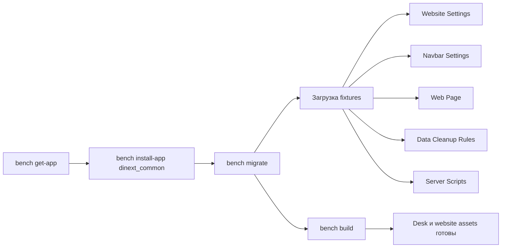
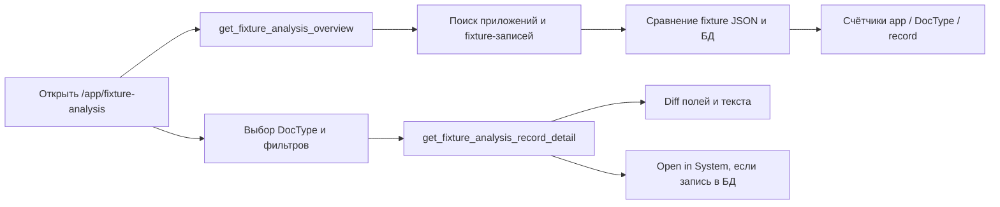
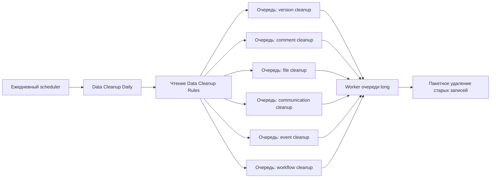

# Dinext Common

## Обзор

Dinext Common — общее Frappe-приложение платформы Dinext. Оно централизует сквозной брендинг, настройки сайта, переиспользуемое поведение Desk, подключаемые frontend-библиотеки и настраиваемую подсистему очистки данных, которую можно установить на несколько сайтов вместе с другими приложениями Dinext или ERPNext.

На практике приложение делает пять вещей:

- применяет общую конфигурацию сайта через fixtures: `Website Settings`, `Navbar Settings`, `Web Page`, `Data Cleanup Rules`, `Server Script`
- подключает общие Desk-ресурсы из `hooks.py`
- предоставляет стандартную тему сайта и брендинговые ресурсы Dinext
- поставляет переиспользуемые JS/CSS-библиотеки, которые другие приложения могут подгружать по требованию
- даёт инструмент Desk для предварительного анализа fixtures по всем установленным приложениям

## Возможности

- Общий брендинг Dinext для Desk и сайта через `app_logo_url`, `app_icon` и `website_context` в `dinext_common/hooks.py`
- Настройка сайта через fixtures: `Website Settings`, `Navbar Settings`, `Data Cleanup Rules`, контент главной страницы Dinext, включённые записи `Server Script` и записи `Custom Field` модуля `Dinext Common`
- Глобальные улучшения Desk через `app_include_js` / `app_include_css`:
  - `breadcrumbs_update.js`
  - `listview_resize.js`
  - `dinext-desk.js`
  - `dashboard_filters_fix.js`
  - `workspace_sidebar_hover.js` + `workspace_sidebar_hover.css` — icon-rail и hover-overlay для списка workspace
- `sticky-datatable.js` только для DocType `Project` через `doctype_js`
- Стандартная тема сайта `Dinext Theme` в `dinext_common/dinext_common/website_theme/dinext_theme/`
- Встроенные frontend-библиотеки:
  - `frappe-datatable.min.js`
  - `hyperlist.js`
  - `frappe-gantt.umd.js`
  - `frappe-gantt.css`
  - `echarts.min.js`
- Страница Desk **Fixture Analysis** (`/app/fixture-analysis`) для сравнения экспортированных fixture-файлов с данными живого сайта до `bench migrate`, с группировкой по приложению, DocType и записи, а также diff на уровне полей и текста для больших скриптов
- Настраиваемая ежедневная очистка данных на основе одного документа `Data Cleanup Rules` и шести дочерних таблиц правил:
  - `Version Cleanup Rule`
  - `Comment Cleanup Rule`
  - `File Cleanup Rule`
  - `Communication Cleanup Rule`
  - `Event Cleanup Rule`
  - `Workflow Cleanup Rule`

## Установка

Установите приложение через Bench:

```bash
cd $PATH_TO_YOUR_BENCH
bench get-app $URL_OF_THIS_REPO --branch develop
bench --site your-site.local install-app dinext_common
```

После установки или обновления выполните миграцию и пересоберите assets, чтобы применились fixtures и Desk-ресурсы:

```bash
bench --site your-site.local migrate
bench build --app dinext_common
```

Если в вашем развёртывании ещё нет брендинговых файлов Dinext, убедитесь, что перед `bench build` они лежат в `dinext_common/public/images/`:

- `DI_SQ_NBG.png`
- `DINEXT_2.png`
- `DINEXT_FAVICON.ico`

## Использование

### Брендинг и общий UI

После установки и миграции:

- в Desk используются логотип и favicon приложения Dinext из `hooks.py`
- на сайте — splash-изображение Dinext и тема `Dinext Theme`
- маршрут главной страницы задаётся fixture `Web Page` с route `homepage`
- в меню Help навбара доступна ссылка на документацию `https://docs.dinext.ru`

### Скрипты Desk

Приложение подключает общее поведение во все сессии Desk:

- `breadcrumbs_update.js` сохраняет контекст workspace в breadcrumbs и поддерживает копирование последнего элемента
- `listview_resize.js` сохраняет ширины колонок списка в `localStorage`
- `dinext-desk.js` настраивает диалог About и показывает версии установленных приложений
- `dashboard_filters_format.js` улучшает динамическую фильтрацию дашборда для `_assign` и `_liked_by`
- `workspace_sidebar_hover.js` — icon-rail workspace-меню на всём Desk: на Workspaces кнопка sidebar переключает полный вид и полоску с иконками; на List/Form/прочих экранах свёрнутый rail показывается принудительно. При наведении меню временно открывается **поверх** контента (без сдвига основной колонки). Состояние свёртки на Workspaces хранится в `localStorage`. DOM меню всегда в `.row.layout-main > .layout-side-section` активной страницы.

Для DocType `Project` подключается `sticky-datatable.js` — виртуализированная таблица с закреплением строк на базе `frappe-datatable.min.js` и `hyperlist.js`.

### Workspace sidebar hover-expand

По умолчанию функция **включена**. Отключение — через `site_config.json` сайта:

```json
{
  "dinext_workspace_sidebar_hover_expand": 0
}
```

Отсутствие ключа или значение `1` / `true` оставляет поведение включённым. После изменения конфига выполните `bench --site your-site.local clear-cache` и обновите Desk (или перелогиньтесь), чтобы подтянуть bootinfo.

Временное открытие по hover — fixed-overlay поверх рабочей области; ширина основного экрана не меняется. Полное разворачивание по кнопке toggle (только на Workspaces) по-прежнему занимает колонку в layout.

На List/Form/Report и других экранах Desk свёрнутый workspace rail монтируется в `.layout-side-section` текущей страницы (при необходимости колонка создаётся). List/form sidebar остаётся рядом и не превращается в icon-rail; кнопка toggle страницы управляет ими, не workspace-меню.

На мобильной ширине остаётся стандартный overlay Frappe.

### Fixture Analysis

Страница **Fixture Analysis** помогает проверить расхождение fixtures перед импортом метаданных на сайт. Режим только чтения: база данных и fixture-файлы не изменяются.

**Доступ:** роль `System Manager` (маршрут Desk `/app/fixture-analysis`). После установки или обновления приложения выполните `bench --site your-site.local migrate`, чтобы создался стандартный документ Page, затем `bench build --app dinext_common`.

**Что сравнивается:**

- JSON fixtures в каждом установленном приложении (`hooks.fixtures` и `fixtures/*.json`)
- текущие записи в базе сайта с учётом фильтров fixtures, если они объявлены в `hooks.py`

**Интерфейс:**

1. **Приложения и DocType** — сводные счётчики по приложению и DocType (`file_only`, `db_only`, `changed`, `equal`)
2. **Записи** — фильтр по статусу и поиск по имени записи или изменённым путям полей
3. **Детали** — diff по полям; для длинного текста (например, поле `script` в `Client Script` / `Server Script`) — построчный diff с номерами строк и контекстом

**Статусы записей:**

| Статус | Значение |
|--------|----------|
| `file_only` | Есть в fixture-файле, нет в БД (будет добавлена при импорте) |
| `db_only` | Есть в БД, нет в fixture-файле |
| `changed` | Запись есть с обеих сторон, но значения полей различаются |
| `equal` | Нет существенных отличий после игнорирования служебных полей метаданных |

Для записей, которые есть в базе, используйте **Open in System**, чтобы перейти к соответствующей форме Frappe (включая Single DocType).

**Whitelisted API** (используется страницей; та же роль `System Manager`):

- `dinext_common.fixture_analysis_api.get_fixture_analysis_overview`
- `dinext_common.fixture_analysis_api.get_fixture_analysis_records`
- `dinext_common.fixture_analysis_api.get_fixture_analysis_record_detail`

Реализация: `dinext_common/fixture_analysis_api.py` и `dinext_common/dinext_common/fixture_analysis/` (`discovery.py`, `diff_engine.py`, `service.py`, `formatters.py`).

### Очистка данных

Подсистема очистки настраивается через единственный документ `Data Cleanup Rules`. Каждая дочерняя таблица задаёт, включена ли очистка, сколько дней истории хранить, и фильтры по типу правила.

Типы правил:

- `Version Cleanup Rule`: по возрасту и опционально по reference DocType
- `Comment Cleanup Rule`: по возрасту, типу комментария и опционально по reference DocType
- `File Cleanup Rule`: по возрасту, типу файла, видимости, папке, размеру, привязанному DocType и полю
- `Communication Cleanup Rule`: по возрасту, типу коммуникации, каналу и опционально по reference DocType
- `Event Cleanup Rule`: по возрасту, категории, типу и статусу события
- `Workflow Cleanup Rule`: по возрасту, опционально по reference DocType и статусу workflow

Приложение также устанавливает из fixtures включённые Server Scripts:

- `Data Cleanup Daily` — ежедневное `Scheduler Event`
- `Data Cleanup Version` — API-метод `dinext_common_data_cleanup_version`
- `Data Cleanup Comment` — API-метод `dinext_common_data_cleanup_comment`
- `Data Cleanup File` — API-метод `dinext_common_data_cleanup_file`
- `Data Cleanup Communication` — API-метод `dinext_common_data_cleanup_communication`
- `Data Cleanup Event` — API-метод `dinext_common_data_cleanup_event`
- `Data Cleanup Workflow` — API-метод `dinext_common_data_cleanup_workflow`

`Data Cleanup Daily` читает актуальный документ `Data Cleanup Rules` и ставит в очередь `long` по одной длительной задаче очистки на каждую включённую категорию. Скрипты очистки удаляют подходящие записи пакетами с периодическим commit.

### Подключение библиотек из других приложений

Автоматически загружаются только библиотеки, нужные самому Dinext Common. Для остальных предпочтительна ленивая загрузка через `frappe.require()` из потребляющего приложения:

```javascript
frappe.require(
	[
		"/assets/dinext_common/js/frappe-gantt.umd.js",
		"/assets/dinext_common/css/frappe-gantt.css",
	],
	function () {
		// Use window.Gantt here.
	}
);
```

```javascript
frappe.require(["/assets/dinext_common/js/echarts.min.js"], function () {
	// Use window.echarts here.
});
```

## Технологии

- Python 3.10+
- Frappe
- JavaScript для кастомизаций Desk
- CSS и SCSS для общих стилей и темы сайта
- Сборка пакета через Flit в `pyproject.toml`
- Pre-commit:
  - `ruff`
  - `eslint`
  - `prettier`
  - `pre-commit-hooks`

## Конфигурация

Основная конфигурация — в `dinext_common/hooks.py`.

Ключевые hooks и настройки:

- `app_logo_url = "/assets/dinext_common/images/DI_SQ_NBG.png"`
- `app_icon = "/assets/dinext_common/images/DINEXT_FAVICON.ico"`
- `website_context` задаёт favicon и splash для публичного сайта
- `app_include_css` подключает `common.css` и `workspace_sidebar_hover.css`
- `app_include_js` подключает общие скрипты Desk глобально (включая `workspace_sidebar_hover.js`)
- `extend_bootinfo = ["dinext_common.boot.extend_bootinfo"]` — передаёт флаг `dinext_workspace_sidebar_hover_expand` из `site_config` в Desk
- `doctype_js = {"Project": "public/js/sticky-datatable.js"}`

Fixtures, экспортируемые приложением:

- `Website Settings`
- `Navbar Settings`
- `Data Cleanup Rules`
- записи `Web Page` с фильтром по модулю `Dinext Common`
- записи `Server Script` с фильтром по модулю `Dinext Common` и `disabled = 0`
- записи `Custom Field` с фильтром по модулю `Dinext Common`
- `Holiday List` с именем `Праздники и выходные РФ`

Поведение fixtures:

- `Website Settings` задаёт публичное имя приложения `Dinext`, `home_page` = `homepage`, отключает регистрацию, баннер и ссылку на `Dinext Theme`
- `Navbar Settings` задаёт логотип и пункты меню: `Documentation`, `About`, `Мои замещения`
- `Web Page` публикует динамическую главную по маршруту `homepage`
- `Data Cleanup Rules` поставляется с правилами хранения по умолчанию: 90 дней для version, communication, event, file и workflow, 45 дней для специализированных правил comment

Замечания по совместимости:

- приложение меняет глобальные объекты сайта (`Navbar Settings`, `Website Settings`)
- подключает JS в каждую сессию Desk
- если другое приложение управляет теми же Single DocType или переопределяет то же поведение Desk, согласуйте владение fixtures и порядок загрузки assets

## Требования

- окружение Bench с установленным Frappe
- Python `>=3.10`
- Node.js для `bench build`
- сайт, на котором можно установить `dinext_common`
- включённые scheduler и workers, если нужна автоматическая ежедневная очистка

Для подсистемы очистки убедитесь, что очередь `long` обслуживается worker: `Data Cleanup Daily` ставит все задачи очистки в `queue="long"`.

## Участие в разработке

Перед коммитами установите и включите pre-commit:

```bash
cd apps/dinext_common
pre-commit install
```

В репозитории настроены проверки:

- валидность JSON, TOML и YAML
- порядок импортов и форматирование Python через `ruff`
- форматирование JavaScript через `prettier`
- линтинг JavaScript через `eslint`
- базовая гигиена: конфликты слияния, отладочные операторы и т.п.

## Документация

- Документация продукта и платформы: [docs.dinext.ru](https://docs.dinext.ru)
- Точка входа конфигурации приложения: `dinext_common/hooks.py`
- Страница Desk Fixture Analysis: `dinext_common/dinext_common/page/fixture_analysis/`
- Backend Fixture Analysis: `dinext_common/dinext_common/fixture_analysis/`
- Схема DocType очистки: `dinext_common/dinext_common/doctype/data_cleanup_rules/`
- Определение темы сайта: `dinext_common/dinext_common/website_theme/dinext_theme/`
- Руководство для агентов разработки: `AGENTS.md`

## Благодарности

- Dinext — брендинг платформы, общие UX-соглашения и сценарии очистки
- Frappe Framework — платформа приложений, fixtures, hooks Desk и планировщик
- Встроенные библиотеки: Frappe DataTable, HyperList, Frappe Gantt, ECharts

## Changelog

В README пока нет отдельного changelog. При необходимости release notes можно собрать из `git log` и кратко описать по релизам.

## Структура репозитория

```text
.
├── AGENTS.md
├── README.md
├── license.txt
├── pyproject.toml
├── .pre-commit-config.yaml
├── dinext_common/
│   ├── __init__.py
│   ├── hooks.py
│   ├── fixture_analysis_api.py
│   ├── modules.txt
│   ├── patches.txt
│   ├── fixtures/
│   │   ├── data_cleanup_rules.json
│   │   ├── navbar_settings.json
│   │   ├── server_script.json
│   │   ├── web_page.json
│   │   └── website_settings.json
│   ├── public/
│   │   ├── css/
│   │   │   ├── common.css
│   │   │   └── frappe-gantt.css
│   │   └── js/
│   │       ├── breadcrumbs_update.js
│   │       ├── dashboard_filters_fix.js
│   │       ├── dinext-desk.js
│   │       ├── echarts.min.js
│   │       ├── frappe-datatable.min.js
│   │       ├── frappe-gantt.umd.js
│   │       ├── hyperlist.js
│   │       ├── listview_resize.js
│   │       └── sticky-datatable.js
│   ├── tests/
│   │   ├── test_fixture_analysis_api.py
│   │   ├── test_fixture_analysis_diff_engine.py
│   │   ├── test_fixture_analysis_discovery.py
│   │   ├── test_fixture_analysis_formatters.py
│   │   ├── test_fixture_analysis_golden.py
│   │   └── test_fixture_analysis_page_assets.py
│   └── dinext_common/
│       ├── doctype/
│       │   ├── communication_cleanup_rule/
│       │   ├── comment_cleanup_rule/
│       │   ├── data_cleanup_rules/
│       │   ├── event_cleanup_rule/
│       │   ├── file_cleanup_rule/
│       │   ├── version_cleanup_rule/
│       │   └── workflow_cleanup_rule/
│       ├── fixture_analysis/
│       │   ├── discovery.py
│       │   ├── diff_engine.py
│       │   ├── formatters.py
│       │   ├── loader.py
│       │   ├── service.py
│       │   └── snapshot.py
│       ├── page/
│       │   └── fixture_analysis/
│       │       ├── fixture_analysis.js
│       │       └── fixture_analysis.json
│       └── website_theme/
│           └── dinext_theme/
```

Основные части репозитория:

- `dinext_common/hooks.py`: метаданные приложения, экспорт fixtures, hooks Desk, JS для Project, пути брендинга
- `dinext_common/fixture_analysis_api.py`: whitelisted API для Fixture Analysis
- `dinext_common/fixtures/`: метаданные уровня сайта, применяемые при миграции
- `dinext_common/public/js/`: глобальные улучшения Desk и сторонние библиотеки
- `dinext_common/public/css/`: общие стили и CSS библиотек
- `dinext_common/dinext_common/fixture_analysis/`: discovery, снимок БД, diff-движок и форматтеры ответов
- `dinext_common/dinext_common/page/fixture_analysis/`: стандартная Desk Page и клиентский UI
- `dinext_common/dinext_common/doctype/`: схема `Data Cleanup Rules` и дочерние DocType правил
- `dinext_common/dinext_common/website_theme/`: документы темы сайта Dinext
- `dinext_common/tests/test_fixture_analysis_*.py`: unit-тесты diff, discovery, API и formatters
- `pyproject.toml`: метаданные Python-пакета и настройки Ruff
- `.pre-commit-config.yaml`: проверки качества для контрибьюторов

## Схемы потоков

### Установка и миграция



### Fixture Analysis



### Ежедневная очистка



## Лицензия

MIT
