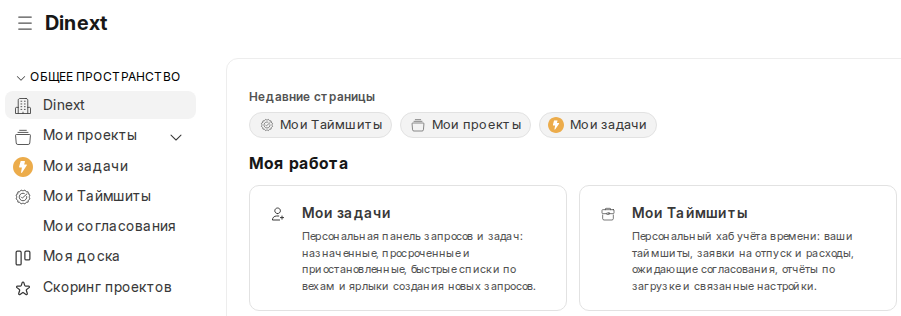
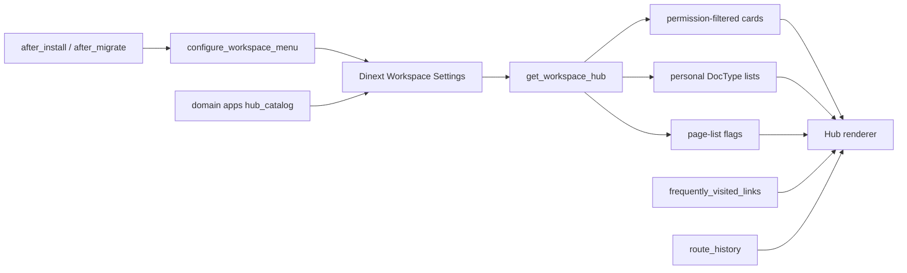
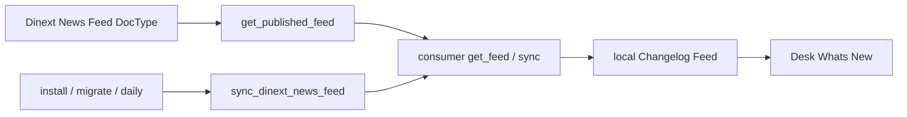
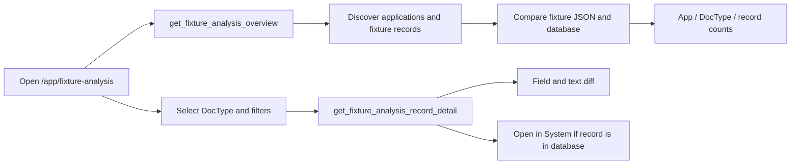
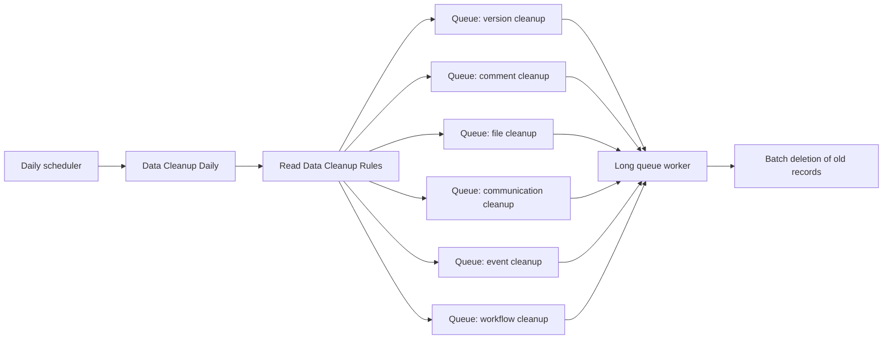

[Русский](README.ru.md)

<!-- dinext-presentation:start -->
<p align="center">
  <a href="https://dinext.ru"></a>
</p>
<h1 align="center">Dinext Common</h1>

<hr>

<p align="center">Shared branding, navigation, settings and reusable interface components for Dinext applications.</p>

<p align="center">
  
</p>
<p align="center"><sub>Shared Dinext navigation and workspace cards.</sub></p>

<p align="center">
  <a href="https://dinext.ru">Website</a> · <a href="https://docs.dinext.ru">Documentation</a>
</p>
<!-- dinext-presentation:end -->

# Dinext Common

`dinext_common` is the shared Frappe application for the Dinext platform. It is installed
into an existing [Bench](https://github.com/frappe/bench) with Frappe and ERPNext and
centralizes platform-wide branding, site settings, reusable
Desk behavior, configurable workspace hubs, the What's New feed, on-demand
frontend libraries and the data cleanup subsystem.

The application is installed on multiple sites together with other Dinext applications.
Domain applications (`dinext_*`) consume its API and assets;
`dinext_common` itself does not seed domain hub cards.

## Contents

- [Overview and responsibilities](#-overview-and-responsibilities)
- [Features](#-features)
- [Installation](#-installation)
- [Usage](#-usage)
- [Technologies](#-technologies)
- [Configuration](#-configuration)
- [Requirements](#-requirements)
- [Development and maintenance](#-development-and-maintenance)
- [Documentation](#-documentation)
- [Changelog](#-changelog)
- [Repository structure](#-repository-structure)
- [Interaction diagram](#-interaction-diagram)
- [License](#-license)

## 📖 Overview and responsibilities

In practice, the application does the following:

- applies shared site configuration through fixtures: `Website Settings`,
  `Navbar Settings`, `Web Page`, `Data Cleanup Rules`, `Server Script`,
  `Custom HTML Block`;
- includes shared Desk assets from `hooks.py`;
- curates the workspace menu: `Dinext` and `Settings` roots, hubs with cards,
  page lists and personal DocType lists;
- publishes and synchronizes the `Dinext News Feed` for Desk What's New;
- provides the standard site theme and Dinext branding assets;
- supplies reusable JS/CSS libraries that other applications
  load on demand;
- provides a Desk tool for previewing and analyzing fixtures across all
  installed applications.

Functionality is divided among applications in the Dinext ecosystem:

| Application | Responsibility |
| --- | --- |
| `dinext_common` | Branding, Desk UX, workspace menus and hubs, News Feed, Fixture Analysis, data cleanup, shared JS/CSS, Dinext chart of accounts template. |
| Domain applications (`dinext_projects`, etc.) | Their own DocTypes, workspaces and hub cards. Register contributions through `dinext_common.setup.hub_catalog`. |
| ERPNext | Required dependency (`required_apps`). Chart of Accounts and Company are overridden only for the `Dinext` template. |

This README is the entry point for installation and maintenance. Common Dinext agent rules
are not copied here: see [AGENTS.md](AGENTS.md).

## ✨ Features

- Shared Dinext branding for Desk and the website through `app_logo_url`, `app_icon` and
  `website_context` in `dinext_common/hooks.py`.
- Site configuration through fixtures: `Website Settings`, `Navbar Settings`,
  `Data Cleanup Rules`, homepage content, enabled `Server Script`,
  `Client Script`, `Custom Field` records in the `Dinext Common` module, `Custom HTML Block`
  (`Dinext Hub`, `Dinext Settings Hub`), `Holiday List` «Праздники и выходные РФ» (Russian Public Holidays and Weekends).
- Desk workspace curation:
  - public root workspaces `Dinext` and `Settings`;
  - hiding public workspaces that do not belong to `dinext_*` modules;
  - ERPNext `Home` remains a hidden record but is not shown in the Desk menu
    (including Workspace Manager) and is not a landing page: `/app/home` → `/app/dinext`;
  - nesting `Users`, `Tools`, `Integrations`, `Build`, `Website` under `Settings`;
  - assigning `Dinext` as `default_workspace` for new users.
- **Dinext Hub** on the `Dinext` workspace: navigation cards, **Frequent
  Pages** / **Recent Pages** lists above sections, and compact personal lists of
  DocType (quick create, assigned, liked, attention).
- **Settings Hub** on the `Settings` workspace (`System Manager` /
  `Workspace Manager` roles): child workspaces and Configuration cards.
- Registration of cards, section limits and DocType contributions from domain applications
  through `dinext_common.setup.hub_catalog`.
- **Dinext News Feed**: publisher DocType, guest API and daily synchronization
  of the local `Changelog Feed`; the standard weekly Frappe changelog fetch
  is disabled.
- Global Desk improvements through `app_include_js` / `app_include_css`:
  - `workspace_slug_redirects.js` redirects old Russian workspace slugs and
    `/app/home` → Dinext without checking the target during boot (`set_route` in the live Desk);
  - `breadcrumbs_update.js`;
  - `listview_resize.js`;
  - `dinext-desk.js`;
  - `dashboard_filters_fix.js`;
  - `workspace_sidebar_hover.js` + `workspace_sidebar_hover.css`.
- `sticky-datatable.js` for the `Project` DocType only, through `doctype_js`.
- Standard `Dinext Theme` site theme.
- On-demand frontend libraries: **DinextTable** (AG Grid 35 Community),
  Form Conflict Merge, `DinextCharts`, Frappe DataTable, HyperList, Frappe Gantt,
  ECharts.
- **Fixture Analysis** Desk page (`/app/fixture-analysis`).
- Configurable daily data cleanup through `Data Cleanup Rules` and six
  child rule tables.
- **Dinext** chart of accounts template: overrides of `Company` and ERPNext methods
  for CoA selection.

## 🚀 Installation

The application is installed into an existing Bench with Frappe and ERPNext. Use
the actual Git URL and branch of your distribution.

```bash
cd /path/to/your/bench
bench get-app <git-url> --branch <branch>
bench --site your-site.local install-app dinext_common
bench --site your-site.local migrate
```

After installation or an update, rebuild assets to apply Desk resources:

```bash
bench build --app dinext_common
bench --site your-site.local clear-cache
```

After installation (`after_install`) and every migration (`after_migrate`), the application
also:

- calls `configure_workspace_menu()` — creates/updates the `Dinext` and
  `Settings` roots, nests child Settings workspaces, attaches the hubs' Custom HTML
  Blocks, creates standard `Dinext Workspace Settings` records
  (`Dinext`, `Settings`), migrates legacy `Настройки` → `Settings`;
- runs `setup_dinext_news_feed()` — disables the built-in Frappe changelog
  fetch and synchronizes What's New.

When a new user has no `default_workspace`, the
`User.after_insert` hook assigns the `Dinext` workspace. The `/app/home` and
`/app/workspaces/home` routes open `Dinext` without a boot-time `slug_exists` check
(in the live Desk through `frappe.set_route`, without reloading the page);
existing `default_workspace` values remain unchanged.

If the deployment does not yet have Dinext branding files, they must be present in
`dinext_common/public/images/` before `bench build`:

- `DI_SQ_NBG.png`
- `DINEXT_2.png`
- `DINEXT_FAVICON.ico`

If the web process runs with Gunicorn `--preload`, restart the web worker after
Python changes; otherwise Desk will continue serving the old code.

## 🛠️ Usage

### Branding and shared UI

After installation and migration:

- Desk uses the Dinext application's logo and favicon from `hooks.py`;
- the website uses the Dinext splash image and `Dinext Theme`;
- the homepage route is defined by a `Web Page` fixture with route `homepage`;
- the navbar's Help menu includes a documentation link to `https://docs.dinext.ru`.

### Desk scripts

The application adds shared behavior to all Desk sessions:

- `workspace_slug_redirects.js` redirects legacy Russian workspace slugs
  (for example, `/app/мои-задачи` → `/app/my-tasks`) after checking the target during boot;
  `/app/home` and `/app/workspaces/home` open `Dinext` without `slug_exists`
  through `frappe.set_route` in the live Desk (without `location.replace`, to
  preserve session `frappe.route_history` / Recent Pages);
  `location.replace` is used only if `set_route` is not yet available;
  updates `localStorage.current_page`;
- `breadcrumbs_update.js` preserves workspace context in breadcrumbs and
  supports copying the last item;
- `listview_resize.js` saves list column widths in `localStorage`;
- `dinext-desk.js` configures the About dialog and displays installed application
  versions;
- `dashboard_filters_fix.js` improves dynamic dashboard filtering for
  `_assign` and `_liked_by`;
- `workspace_sidebar_hover.js` provides a workspace menu icon rail throughout Desk: on
  Workspaces, the sidebar button toggles the full view and icon strip; on
  List/Form/other screens, the collapsed rail is forced. Hovering
  temporarily opens the menu **over** the content (without moving the main
  column). The collapsed state on Workspaces is stored in `localStorage`. The menu DOM
  is always in the active page's `.row.layout-main > .layout-side-section`.

For the `Project` DocType, `sticky-datatable.js` provides a virtualized
table with pinned rows, based on `frappe-datatable.min.js` and `hyperlist.js`.

### Workspace sidebar hover-expand

The feature is **enabled** by default. Disable it through the site's `site_config.json`:

```json
{
  "dinext_workspace_sidebar_hover_expand": 0
}
```

An absent key or a value of `1` / `true` keeps the behavior enabled.
After changing the configuration, run `bench --site your-site.local clear-cache`
and refresh Desk (or sign in again) to load updated bootinfo.

Temporary opening on hover uses a fixed overlay over the work area; the main
screen width does not change. Full expansion through the toggle button (on Workspaces
only) still occupies a layout column.

On Workspaces, when the sidebar is collapsed, a small left padding is added to the main
column (`--dinext-ws-rail-pad-left`) so content does not touch the
icon rail. On List/Form/Report and other Desk screens, the collapsed workspace rail
mounts in the current page's `.layout-side-section` (creating the column if
necessary). The list/form sidebar remains alongside it and does not become an
icon rail; the page toggle button controls those sidebars, rather than the workspace menu. On the Form
of a saved document, the native form sidebar is open by default; for a new,
unsaved document, Frappe continues to hide it until Save.

The standard Frappe overlay remains at mobile widths.

### Dinext Hub and Settings Hub

The `Dinext` workspace displays **Dinext Hub**, while the
`Settings` workspace displays **Dinext Settings Hub**. Both blocks are thin adapters: HTML sets
`data-settings-name`, the script loads
`/assets/dinext_common/js/workspace_hub.js` and calls
`dinext_common.workspace_hub.mount(root_element)`. Styles are injected into the shadow
root from `/assets/dinext_common/css/workspace_hub.css`. The blocks are attached during
`configure_workspace_menu()` on install and migrate.

Administrators configure hub content through named **Dinext Workspace Settings** DocType
records (write access: `System Manager` /
`Workspace Manager`; hub reading is available to Desk User if the record has no
restricting `roles`):

| Field / table | Purpose |
| --- | --- |
| `settings_name` | Unique record key (`Dinext`, `Settings`, or another application's key). The document name matches the key. |
| `show_frequent_pages` / `show_recent_pages` | **Page Lists** section checkboxes (enabled by default). On the **`Settings`** record, both flags are forcibly disabled during configuration. |
| `roles` | When specified, the hub API returns the catalog only to users holding one of these roles. For `Settings`, defaults are `System Manager`, `Workspace Manager`. |
| `items` (`Dinext Workspace Settings Item`) | Navigation cards: section, type (`Workspace` / `DocType` / `Report` / `Page` / `URL`), target, label, description, icon, enabled, optional `required_role`. |
| `sections` (`Dinext Workspace Settings Section`) | Personal list limit (`list_limit`, default **5**) and maximum card columns (`card_columns`, default **4**; the seeded `Settings` record has **3** / **3** for Workspaces and `card_columns` **5** for Configuration). When there are fewer cards than the limit, the row fills the width. Registration does not overwrite previously saved rows. |
| `doctype_items` (`Dinext Workspace Settings DocType`) | DocType contributions to a section: quick create, assigned, liked, attention, JSON `attention_filter` and shared JSON `list_filter` for assigned/liked. |

Standard records created by `dinext_common`:

- **`Dinext`** — the Dinext Hub catalog. Domain applications register
  cards here through `register_hub_*` (the default name).
- **`Settings`** — the Settings Hub catalog: Workspaces (`Users`, `Tools`,
  `Integrations`, `Build`, `Website`) and Configuration sections (five Frappe core
  Singles: System Settings, Session Default Settings, Document Naming
  Settings, Log Settings, Global Search Settings). Frequent Pages and Recent
  Pages are disabled on this record.

Another application can:

- add rows to `Dinext` or `Settings` without a new Custom HTML Block —
  the corresponding hub will pick them up;
- create its own named record; displaying it on a Workspace
  requires a thin Custom HTML Block with `data-settings-name="<name>"` and a widget in
  `Workspace.content`.

**Shared API** (`dinext_common.workspace_hub.get_workspace_hub(settings_name)`):

- returns only enabled cards for the selected record that are accessible to the current
  user under record roles, `required_role` and target permissions;
- root fields: `show_frequent_pages`, `show_recent_pages`, `page_list_limit`
  (currently **5**);
- each section can show compact personal lists:
  - **Quick Create** — if the user has `create` permission (buttons, not list rows);
  - **Assigned** — open `ToDo` records assigned to the user, followed by an optional
    `list_filter`;
  - **Liked** — documents with `_liked_by` and the same optional `list_filter`;
  - **Attention** — `frappe.get_list` using the JSON `attention_filter` (an empty filter means all
    accessible documents within the limit). `list_filter` does not apply to Attention.

Page lists are **rendered by the client**, not the API:

| List | Source | Behavior |
| --- | --- | --- |
| Frequent Pages | `frappe.boot.frequently_visited_links` | Up to `page_list_limit` useful routes. |
| Recent Pages | Session `frappe.route_history` | Newest first, no duplicates, excluding the current workspace page. |

The client renders Frequent Pages and Recent Pages as **two rows of pills**
(icon + text; hover outlines use Desk CSS variables). **Recent Pages** is
at the top, **Frequent Pages** below. The Workspace icon comes from
`frappe.boot.allowed_workspaces` (not `frappe.workspaces`, where the
`icon` field disappears after opening a Workspace). A Workspace pill shows only the workspace
name, without the word Workspace. A Form pill shows the document's `title_field`
or `name` according to its Naming Rule, without a DocType prefix; full context remains in the
tooltip. Lists include `Form` / `List` / `Tree` / `Workspaces` /
`query-report` routes. `setup-wizard`, `social`, `recorder` and
`new-*` forms are skipped. Empty groups are hidden. Returning to Workspaces without a full
reload refreshes the hub through `frappe.router.on("change")`. Lists do not
persist across a full Desk reload beyond the data available in boot and the session.

A **Report** card opens as
`/app/query-report/{urlencoded report name}` (not a slug); otherwise Desk looks up
the Report document by slug and cannot find `Task Epic Burndown`.

`get_dinext_hub` and `get_settings_hub` are backward-compatible wrappers for the
`Dinext` and `Settings` records.

Whitelisted hub methods:

- `dinext_common.workspace_hub.get_workspace_hub`
- `dinext_common.workspace_hub.get_dinext_hub`
- `dinext_common.workspace_hub.get_settings_hub`

There is no Recently Opened column by DocType: Frappe does not store Form routes in the
`Route History` DocType. The `show_recently_opened` field and child DocType were removed.

### Registering Hub cards from domain applications

Domain applications (`dinext_*`) register their cards and lists from
`after_install` / `after_migrate`. `dinext_common` does **not** seed domain
cards — their owning apps add them.

```python
from dinext_common.setup.hub_catalog import (
	register_hub_doctype_items,
	register_hub_items,
	register_hub_sections,
	relocate_hub_item_section,
)

register_hub_items(
	[
		{
			"section": "My Work",
			"element_type": "Workspace",
			"target": "Мои задачи",
			"label": "My Tasks",
			"description": "Personal dashboard for assigned work.",
			"icon": "assign",
			"enabled": 1,
		}
	],
	source_app="dinext_projects",
)

register_hub_sections(
	[{"section": "My Work", "list_limit": 5}],
	source_app="dinext_projects",
)

register_hub_doctype_items(
	[
		{
			"section": "My Work",
			"document_type": "Task",
			"show_quick_create": 1,
			"show_assigned": 1,
			"show_liked": 1,
			"show_attention": 1,
			"attention_filter": '[["status","=","Open"]]',
			"list_filter": '[["type","!=","Issue"]]',
		}
	],
	source_app="dinext_projects",
)
```

Idempotency contract:

- cards: the `(element_type, target)` key — existing rows retain
  administrator edits (label, description, icon, section, enabled, role);
  an empty icon may be backfilled;
- sections: the `section` key — administrator `list_limit` and `card_columns` values
  are not overwritten;
- DocType contributions: the `(section, document_type, source_app)` key — a nonempty
  `list_filter` and other administrator flags are not overwritten; an empty
  `list_filter` is populated from registration; `show_assigned` and
  `show_quick_create` are enabled in one direction (`0` → `1`), never disabled;
- unknown keys, such as legacy `show_recently_opened` / `recent`,
  are ignored;
- `relocate_hub_item_section(...)` changes only the `section` of an existing
  card;
- all `register_hub_*` methods accept `settings_name` (default `"Dinext"`);
  deduplication keys apply within the selected record.

Dinext Hub catalog rules:

- **Project Management** — DocType lists contain only `Project` and
  `Project Portfolio` (Task and Issue remain in My Work). Both contributions
  enable Assigned and Quick Create. Gantt registers the
  Task Epic Burndown report card and does not register Task in this section.
- Standard `list_filter` (open work, not Attention): Task —
  `type != Issue` and `status not in Completed/Cancelled`; Issue —
  `status in Open/Replied/On Hold`; Project — `status not in
  Completed/Cancelled`; Project Portfolio — `status = Активный` (Active).
- **Scope & Governance** is not populated: `dinext_project_scope`,
  `dinext_risk_management` and `dinext_project_stage_gate` no longer
  register cards. Registration does not delete rows already stored.

### Dinext News Feed / What's New

This subsystem replaces Frappe's standard weekly changelog aggregation
with Dinext's own feed.

**Publisher** (normally the documentation site where content is maintained):

- DocType `Dinext News Feed`: `title`, `app_name`, `link`,
  `posting_timestamp`, `is_published`;
- the guest API `dinext_common.changelog_feed.get_published_feed` returns up to 20
  published records newer than `since`.

**Consumer** (ERP/Desk sites):

- hook `get_changelog_feed = dinext_common.changelog_feed.get_feed`;
- daily scheduler `dinext_common.changelog_feed.sync_dinext_news_feed`;
- the same setup runs from `after_install` and `after_migrate`;
- on success, the local `Changelog Feed` is completely replaced with publisher data;
- on network/HTTP errors, the local feed is **not** cleared; the error is written to Error Log.

The publisher URL is set in `site_config.json` (default:
`https://docs.dinext.ru`):

```json
{
  "dinext_news_feed_url": "https://docs.dinext.ru"
}
```

Daily synchronization requires the scheduler, workers and network access
from the consumer site to the publisher URL.

### Fixture Analysis

The **Fixture Analysis** page helps check fixture differences before
importing metadata into the site. It is read-only: the database and fixture files
are not modified.

**Access:** the `System Manager` role (Desk route `/app/fixture-analysis`). After
installing or updating the application, run
`bench --site your-site.local migrate` to create the standard Page
document, then `bench build --app dinext_common`.

**What is compared:**

- JSON fixtures in each installed application (`hooks.fixtures` and
  `fixtures/*.json`);
- current records in the site database, respecting fixture filters if declared in
  `hooks.py`.

**Interface:**

1. **Applications and DocTypes** — summary counts by application and DocType
   (`file_only`, `db_only`, `changed`, `equal`).
2. **Records** — status filter and search by record name or changed field
   paths.
3. **Details** — field-level diff; for long text (for example, `script` in
   `Client Script` / `Server Script`), a line-by-line diff with line numbers and
   context.

**Record statuses:**

| Status | Meaning |
| --- | --- |
| `file_only` | Present in the fixture file, absent from the database (will be added on import). |
| `db_only` | Present in the database, absent from the fixture file. |
| `changed` | The record exists on both sides, but field values differ. |
| `equal` | No significant differences after ignoring internal metadata fields. |

For records that exist in the database, use **Open in System** to open
the corresponding Frappe form (including Single DocTypes).

**Whitelisted API** (used by the page; the same `System Manager` role):

- `dinext_common.fixture_analysis_api.get_fixture_analysis_overview`
- `dinext_common.fixture_analysis_api.get_fixture_analysis_records`
- `dinext_common.fixture_analysis_api.get_fixture_analysis_record_detail`

Implementation: `dinext_common/fixture_analysis_api.py` and
`dinext_common/dinext_common/fixture_analysis/` (`discovery.py`,
`diff_engine.py`, `service.py`, `formatters.py`).

### Data cleanup

The cleanup subsystem is configured through the single
`Data Cleanup Rules` document. Each child table defines whether cleanup is enabled,
how many days of history to retain, and filters specific to the rule type.

Rule types:

- `Version Cleanup Rule`: by age and optionally by reference DocType;
- `Comment Cleanup Rule`: by age, comment type and optionally by
  reference DocType;
- `File Cleanup Rule`: by age, file type, visibility, folder, size,
  linked DocType and field;
- `Communication Cleanup Rule`: by age, communication type, channel and
  optionally by reference DocType;
- `Event Cleanup Rule`: by age, category, type and event status;
- `Workflow Cleanup Rule`: by age, optionally by reference DocType and
  workflow status.

The application also installs enabled Server Scripts from fixtures:

- `Data Cleanup Daily` — daily `Scheduler Event`;
- `Data Cleanup Version` — the `dinext_common_data_cleanup_version` API method;
- `Data Cleanup Comment` — the `dinext_common_data_cleanup_comment` API method;
- `Data Cleanup File` — the `dinext_common_data_cleanup_file` API method;
- `Data Cleanup Communication` — the `dinext_common_data_cleanup_communication` API method;
- `Data Cleanup Event` — the `dinext_common_data_cleanup_event` API method;
- `Data Cleanup Workflow` — the `dinext_common_data_cleanup_workflow` API method.

`Data Cleanup Daily` reads the current `Data Cleanup Rules` document and queues
one long-running cleanup job in `long` for each enabled
category. Cleanup scripts delete matching records in batches with periodic
commit.

### On-demand libraries

Only libraries needed by Dinext Common itself are loaded automatically. For
other libraries, lazy loading through `frappe.require()` from the
consuming application is preferred.

**DinextTable** — an editable table built on AG Grid 35 Community. Core documentation:
[`dinext_common/public/js/table/README.md`](dinext_common/public/js/table/README.md).

```javascript
frappe.require(["dinext-table.bundle.js"], () => {
	DinextTable.create({ container, data, columns, edit: true });
});
```

**Form Conflict Merge** is included through the
`form-conflict-merge.bundle.js` bundle; sources are in
`dinext_common/public/js/form_conflict_merge/`. The consuming application
calls `dinext_common.formConflictMerge.install(...)`.

**DinextCharts** (`dinext_common/public/js/charts/dinext-charts-core.js`) lazily
loads ECharts and provides panel helpers consistent with the Desk theme.

Other assets:

```javascript
frappe.require(
	[
		"/assets/dinext_common/js/frappe-gantt.umd.js",
		"/assets/dinext_common/css/frappe-gantt.css",
	],
	function () {
		// Use window.Gantt here.
	}
);
```

```javascript
frappe.require(["/assets/dinext_common/js/echarts.min.js"], function () {
	// Use window.echarts here.
});
```

### Dinext chart of accounts

`override_doctype_class` for `Company` and `override_whitelisted_methods` for
CoA selection substitute the **Dinext** template from
`dinext_common/setup/data/coa_importer_template.xlsx` if the company is not
copying the chart of accounts from an existing company.

## 📦 Technologies

- **Backend:** Python 3.10+, Frappe Framework, ERPNext.
- **Frontend:** JavaScript for Desk customizations; CSS/SCSS for shared styles and
  the website theme.
- **Tables:** AG Grid Community 35 (DinextTable).
- **Data:** MariaDB or PostgreSQL through the Frappe ORM.
- **Package build:** `flit_core` in `pyproject.toml`.
- **Code quality:** pre-commit (`ruff`, `eslint`, `prettier`,
  `pre-commit-hooks`).

## 🔧 Configuration

The main configuration is in `dinext_common/hooks.py`.

Key hooks and settings:

- `app_logo_url = "/assets/dinext_common/images/DI_SQ_NBG.png"`
- `app_icon = "/assets/dinext_common/images/DINEXT_FAVICON.ico"`
- `website_context` sets the favicon and splash image for the public website
- `app_include_css` includes `common.css` and `workspace_sidebar_hover.css`
- `app_include_js` includes shared Desk scripts globally (including
  `workspace_slug_redirects.js` and `workspace_sidebar_hover.js`)
- `extend_bootinfo = ["dinext_common.boot.extend_bootinfo"]` passes the
  `dinext_workspace_sidebar_hover_expand` flag from `site_config` to Desk and removes
  `Home` from `allowed_workspaces`
- `after_install = "dinext_common.install.after_install"`
- `after_migrate` — news feed setup and `configure_workspace_menu`
- `doc_events.User.after_insert` →
  `dinext_common.setup.workspace.set_default_workspace_for_new_user`
- `scheduler_events.daily` →
  `dinext_common.changelog_feed.sync_dinext_news_feed`
- `get_changelog_feed = "dinext_common.changelog_feed.get_feed"`
- `doctype_js = {"Project": "public/js/sticky-datatable.js"}`
- `has_permission` for `Dinext Workspace Settings`
- `override_doctype_class` / `override_whitelisted_methods` for the Dinext CoA and
  the `Home` filter in `get_workspace_sidebar_items`

`site_config.json` options:

```json
{
  "dinext_workspace_sidebar_hover_expand": 1,
  "dinext_news_feed_url": "https://docs.dinext.ru",
  "dinext_hidden_apps": ["erpnext", "hrms"]
}
```

- `dinext_workspace_sidebar_hover_expand` — enable/disable sidebar hover expansion
  (enabled by default);
- `dinext_news_feed_url` — base URL publisher News Feed; trailing slash
  is trimmed; an empty value means `https://docs.dinext.ru`.
- `dinext_hidden_apps` — the complete list of app names hidden on the
  `/apps` page and in the app list API. If the key is absent,
  `erpnext` and `hrms` are hidden; `[]` hides no applications. The name
  corresponds to `app_name`, for example `crm`, rather than the tile's visible title.

After changing `dinext_hidden_apps`, run
`bench --site your-site.local migrate` — this assigns `dinext_common`
as the system and user default app if the previous default is empty or has become
hidden. Then run `bench --site your-site.local clear-cache` and
reload Desk. An explicit default pointing to a visible application is not overwritten.
With Gunicorn `--preload`, restart the web worker.

This repository declares no environment variables of its own: site parameters
use the standard Bench/Frappe mechanism.

Fixtures exported by the application:

- `Website Settings`
- `Navbar Settings`
- `Data Cleanup Rules`
- `Web Page` records filtered by the `Dinext Common` module
- `Client Script` records filtered by the `Dinext Common` module
- `Server Script` records filtered by the `Dinext Common` module and `disabled = 0`
- `Custom Field` records filtered by the `Dinext Common` module
- `Custom HTML Block` records named `Dinext Hub`, `Dinext Settings Hub`
- `Holiday List` named `Праздники и выходные РФ`

Fixture behavior:

- `Website Settings` sets the public application name to `Dinext`,
  `home_page` = `homepage`, and disables registration, the banner and the link to
  `Dinext Theme`;
- `Navbar Settings` sets the logo and menu items: `Documentation`, `About`,
  `Мои замещения` (My Delegations);
- `Web Page` publishes the dynamic homepage at the `homepage` route;
- `Custom HTML Block` provides thin adapters for the Dinext / Settings hubs
  (`data-settings-name` + `frappe.require` of the shared renderer);
- `Data Cleanup Rules` is supplied with default retention rules: 90 days
  for version, communication, event, file and workflow, and 45 days for
  specialized comment rules.

Compatibility notes:

- the application changes global site objects (`Navbar Settings`,
  `Website Settings`);
- includes JS in every Desk session;
- curates the public workspace menu and may hide workspaces from third-party modules;
- if another application manages the same Single DocTypes or overrides
  the same Desk behavior, coordinate fixture ownership and asset loading order.

After changing workspace/feed logic, run
`bench --site your-site.local migrate`. After frontend asset changes, run
`bench build --app dinext_common` and
`bench --site your-site.local clear-cache`. After metadata changes,
export fixtures:

```bash
bench --site your-site.local export-fixtures
```

## ✅ Requirements

- [Bench](https://github.com/frappe/bench) with Frappe installed.
- The `required_apps = ["erpnext"]` dependency.
- Python `>=3.10` (declared in `pyproject.toml`).
- Frappe/ERPNext versions compatible with your Dinext distribution.
- Node.js for `bench build`.
- A site where `dinext_common` can be installed.
- Enabled scheduler and workers if automatic daily cleanup
  and News Feed synchronization are needed.
- Network access from the consumer site to the publisher URL (`dinext_news_feed_url`) for
  What's New.
- For local checks: pre-commit; for table JS tests: Node.js.

For the cleanup subsystem, make sure a worker serves the `long` queue:
`Data Cleanup Daily` places all cleanup jobs in `queue="long"`.

## 🤝 Development and maintenance

Before any change, follow the mandatory OpenSpec lifecycle in
[AGENTS.md](AGENTS.md).
Local `openspec/specs` and `openspec/changes` directories are not
created in this repository.

Before committing, install and enable pre-commit:

```bash
cd apps/dinext_common
pre-commit install
```

The repository is configured with these checks:

- JSON, TOML and YAML validity;
- Python import ordering and formatting through `ruff`;
- JavaScript formatting through `prettier`;
- JavaScript linting through `eslint`;
- basic hygiene: merge conflicts, debug statements, etc.

Additional JS tests from the application root:

```bash
npm run test:dinext-table
npm run test:form-conflict-merge
```

Python tests for workspaces, news feed, boot, CoA and Fixture Analysis are in
`dinext_common/tests/`.

## 📄 Documentation

- Product and platform documentation: [docs.dinext.ru](https://docs.dinext.ru)
- Agent navigation stub: [AGENTS.md](AGENTS.md)
- Application configuration entry point: `dinext_common/hooks.py`
- Installation and post-install: `dinext_common/install.py`
- Bootinfo Desk: `dinext_common/boot.py`
- Workspace curation: `dinext_common/setup/workspace.py`
- Hub registration from domain apps: `dinext_common/setup/hub_catalog.py`
- Hub APIs: `dinext_common/workspace_hub.py`,
  `dinext_common/workspace_hub_lists.py`,
  `dinext_common/workspace_hub_models.py`
- News Feed publisher/consumer: `dinext_common/changelog_feed.py`
- Hub settings DocType:
  `dinext_common/dinext_common/doctype/dinext_workspace_settings/`
- News DocType: `dinext_common/dinext_common/doctype/dinext_news_feed/`
- Hub Custom HTML Blocks: `dinext_common/fixtures/custom_html_block.json`
- Fixture Analysis Desk page:
  `dinext_common/dinext_common/page/fixture_analysis/`
- Backend Fixture Analysis: `dinext_common/dinext_common/fixture_analysis/`
- Cleanup DocType schema:
  `dinext_common/dinext_common/doctype/data_cleanup_rules/`
- Website theme definition:
  `dinext_common/dinext_common/website_theme/dinext_theme/`
- DinextTable: `dinext_common/public/js/table/README.md`
- Translations: `dinext_common/translations/ru.csv`
- Tests: `dinext_common/tests/`

## 📝 Changelog

A brief summary of the current repository state and recent commits. The full
log is in the specific branch's Git history.

### 2026-09-10

- Workspaces section seed for the `Settings` record: `list_limit` 3 and `card_columns` 3;
  Configuration remains at `card_columns` 5. Existing rows are not
  overwritten.

### 2026-08-14

- Desk landing: ERPNext `Home` is hidden and excluded from the menu (including Workspace
  Manager); `/app/home` and `/app/workspaces/home` open `Dinext`.
- Frequent / Recent Pages use two rows of pills, with Recent at the top; Workspace
  icons come from boot, Workspace labels show only the name, and Form labels use
  `title_field` or `name`. On the `Settings` record, both checkboxes are disabled; on
  `Dinext`, they remain enabled.
- Hub Report cards link to `/app/query-report/{report name}`.
- Catalog: Project Management has no Task/Issue lists from Gantt; Scope &
  Governance is no longer registered.
- Removed the Recently Opened DocType column, the `show_recently_opened` field and
  whitelist `get_document_titles`.
- Quick Create remains buttons; section list records are compact
  rows.

### 2026-08-13

- Hub sections: `card_columns` is the maximum number of card grid columns (default
  4, or 5 for `Settings`); fewer cards produce a full-width row.
- `Dinext Workspace Settings` uses named `Dinext` and `Settings` records
  instead of a Single; shared `get_workspace_hub` and renderer in
  `public/js/workspace_hub.js`.
- Settings Hub reads the `Settings` record; domain apps can extend
  standard records without a new block.
- `configure_workspace_menu` also runs on `after_migrate`.

### 2026-08-11 — 2026-08-12

- Workspace menu: `Dinext` / `Settings` roots, hiding non-Dinext public
  workspaces, nesting Settings children, `default_workspace` for new
  users.
- Dinext Hub and Settings Hub: bilingual Custom HTML Blocks and configurable
  cards through `Dinext Workspace Settings`.
- Sidebar UI: left padding for the main Workspaces column when the rail is collapsed.
- Dinext News Feed: publisher DocType + guest API, consumer sync What's New,
  disabling the built-in Frappe changelog fetch.
- Domain apps: idempotent card registration through `register_hub_items` /
  `register_hub_sections` / `register_hub_doctype_items`.
- Settings Hub: `Website` under Settings and a Configuration section.
- Compact Hub lists: personal quick-create / assigned / liked / attention
  lists by section, with a limit.

## 🗂️ Repository structure

```text
dinext_common/
├── AGENTS.md                         # Agent instructions
├── README.md                         # This document
├── license.txt                       # GPL-3 license
├── pyproject.toml                    # Package metadata, Python and ruff
├── package.json                      # JS test npm scripts
├── .pre-commit-config.yaml           # Local checks
├── openspec/config.yaml              # OpenSpec configuration
├── scripts/                          # Form Conflict Merge scenarios
└── dinext_common/
    ├── hooks.py                      # App configuration, fixtures, Desk hooks
    ├── install.py                    # after_install
    ├── boot.py                       # Desk bootinfo
    ├── changelog_feed.py             # News Feed publisher/consumer
    ├── workspace_hub.py              # Whitelisted hub API
    ├── workspace_hub_lists.py        # Personal DocType lists
    ├── workspace_hub_models.py       # TypedDict hub payload
    ├── fixture_analysis_api.py       # Whitelisted API Fixture Analysis
    ├── modules.txt                   # Desk module name
    ├── patches.txt                   # Migration patch list
    ├── patches/                      # Single → named settings migration
    ├── fixtures/                     # Exported Frappe metadata
    ├── translations/ru.csv           # Russian translations
    ├── public/css/                   # Shared styles, hub, sidebar, AG Grid
    ├── public/js/                    # Desk JS, hub, table, FCM, charts
    ├── public/images/                # Dinext branding
    ├── setup/                        # Workspace menu, hub catalog, CoA
    ├── tests/                        # Python tests
    └── dinext_common/
        ├── doctype/                  # Settings, News Feed, cleanup, Workflow Task
        ├── fixture_analysis/         # Fixture discovery and diff
        ├── page/fixture_analysis/    # Desk Page
        ├── workspace/                # Dinext, Settings
        └── website_theme/            # Dinext Theme
```

Main components:

- `dinext_common/hooks.py` — application metadata, fixture exports, Desk
  hooks, install/migrate, news feed, Project JS, branding paths.
- `dinext_common/install.py` — post-install: news feed + configure workspace
  menu.
- `dinext_common/setup/workspace.py` — workspace menu curation and connection of
  hub blocks.
- `dinext_common/setup/hub_catalog.py` — registration of cards/sections/DocType contributions.
- `dinext_common/setup/company.py` and `chart_of_accounts.py` — Dinext CoA template.
- `dinext_common/public/js/workspace_hub.js` — shared hub renderer, including
  page lists.
- `dinext_common/public/js/table/` — DinextTable core.
- `dinext_common/public/js/form_conflict_merge/` — form conflict merging.
- `openspec/config.yaml` — Store pointer; does not duplicate specs/changes.

Generated `public/dist/` assets are not included in the current structure description.

## 🔗 Interaction diagram

Bench loads `hooks.py`. Fixtures form site metadata, while `after_install`
and `after_migrate` configure the workspace menu and News Feed. Domain applications
register hub cards in named settings records. The hub renderer
adds page lists from boot and session route history.

### Installation and migration


### Dinext Hub



### Dinext News Feed



### Fixture Analysis



### Daily cleanup



## 📜 License

GNU GPL v3. See [license.txt](license.txt) for the license text.
