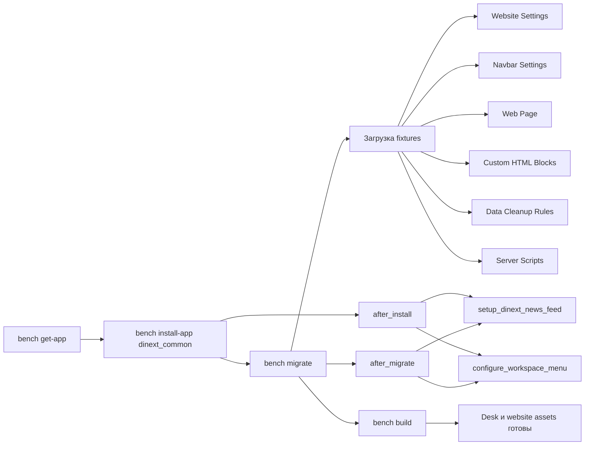
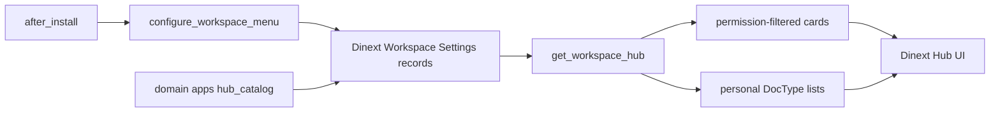
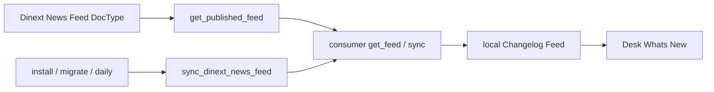
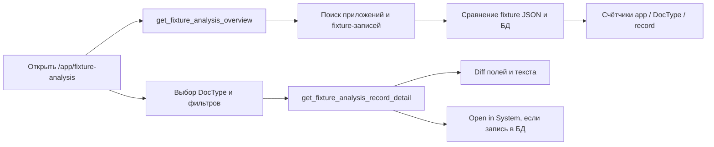
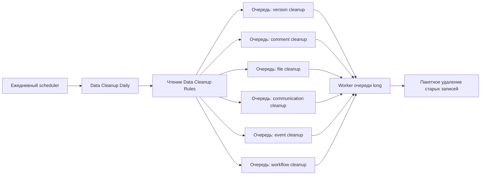

# Dinext Common

## Обзор

Dinext Common — общее Frappe-приложение платформы Dinext. Оно централизует сквозной брендинг, настройки сайта, переиспользуемое поведение Desk, настраиваемые workspace-хабы, ленту новостей What's New, подключаемые frontend-библиотеки и подсистему очистки данных, которую можно установить на несколько сайтов вместе с другими приложениями Dinext или ERPNext.

На практике приложение делает следующее:

- применяет общую конфигурацию сайта через fixtures: `Website Settings`, `Navbar Settings`, `Web Page`, `Data Cleanup Rules`, `Server Script`, `Custom HTML Block`
- подключает общие Desk-ресурсы из `hooks.py`
- курирует меню workspace: корневые `Dinext` и `Settings`, хабы с карточками и персональными списками
- публикует и синхронизирует ленту `Dinext News Feed` для Desk What's New
- предоставляет стандартную тему сайта и брендинговые ресурсы Dinext
- поставляет переиспользуемые JS/CSS-библиотеки, которые другие приложения могут подгружать по требованию
- даёт инструмент Desk для предварительного анализа fixtures по всем установленным приложениям

## Возможности

- Общий брендинг Dinext для Desk и сайта через `app_logo_url`, `app_icon` и `website_context` в `dinext_common/hooks.py`
- Настройка сайта через fixtures: `Website Settings`, `Navbar Settings`, `Data Cleanup Rules`, контент главной страницы Dinext, включённые записи `Server Script`, `Client Script`, `Custom Field` модуля `Dinext Common`, а также `Custom HTML Block` (`Dinext Hub`, `Dinext Settings Hub`)
- Курирование Desk workspace:
  - публичные корневые workspace `Dinext` и `Settings`
  - скрытие public-workspace, не принадлежащих модулям `dinext_*`
  - вложение `Users`, `Tools`, `Integrations`, `Build`, `Website` под `Settings`
  - назначение `Dinext` как `default_workspace` новым пользователям
- **Dinext Hub** на workspace `Dinext`: настраиваемые навигационные карточки и компактные персональные списки DocType по секциям (quick create, recently opened, assigned, liked, attention)
- **Settings Hub** на workspace `Settings` (роли `System Manager` / `Workspace Manager`): дочерние workspace и карточки Configuration
- Регистрация карточек, лимитов секций и DocType-вкладов из domain-приложений через `dinext_common.setup.hub_catalog`
- **Dinext News Feed**: DocType-публикатор, guest API и ежедневная синхронизация local `Changelog Feed` на consumer-сайтах; стандартная еженедельная загрузка changelog Frappe отключается
- Глобальные улучшения Desk через `app_include_js` / `app_include_css`:
  - `breadcrumbs_update.js`
  - `listview_resize.js`
  - `dinext-desk.js`
  - `dashboard_filters_fix.js`
  - `workspace_sidebar_hover.js` + `workspace_sidebar_hover.css` — icon-rail и hover-overlay для списка workspace
- `sticky-datatable.js` только для DocType `Project` через `doctype_js`
- Стандартная тема сайта `Dinext Theme` в `dinext_common/dinext_common/website_theme/dinext_theme/`
- Встроенные frontend-библиотеки:
  - `frappe-datatable.min.js`
  - `hyperlist.js`
  - `frappe-gantt.umd.js`
  - `frappe-gantt.css`
  - `echarts.min.js`
- Страница Desk **Fixture Analysis** (`/app/fixture-analysis`) для сравнения экспортированных fixture-файлов с данными живого сайта до `bench migrate`, с группировкой по приложению, DocType и записи, а также diff на уровне полей и текста для больших скриптов
- Настраиваемая ежедневная очистка данных на основе одного документа `Data Cleanup Rules` и шести дочерних таблиц правил:
  - `Version Cleanup Rule`
  - `Comment Cleanup Rule`
  - `File Cleanup Rule`
  - `Communication Cleanup Rule`
  - `Event Cleanup Rule`
  - `Workflow Cleanup Rule`

## Установка

Установите приложение через Bench:

```bash
cd $PATH_TO_YOUR_BENCH
bench get-app $URL_OF_THIS_REPO --branch develop
bench --site your-site.local install-app dinext_common
```

После установки или обновления выполните миграцию и пересоберите assets, чтобы применились fixtures и Desk-ресурсы:

```bash
bench --site your-site.local migrate
bench build --app dinext_common
```

После установки (`after_install`) и каждой миграции (`after_migrate`) приложение дополнительно:

- вызывает `configure_workspace_menu()` — создаёт/обновляет корни `Dinext` и `Settings`, вкладывает дочерние Settings-workspace, подключает Custom HTML Blocks хабов, создаёт стандартные записи `Dinext Workspace Settings` (`Dinext`, `Settings`), мигрирует legacy `Настройки` → `Settings`
- запускает `setup_dinext_news_feed()` — отключает встроенный Frappe changelog fetch и синхронизирует What's New

При создании нового пользователя без `default_workspace` hook `User.after_insert` назначает workspace `Dinext`.

Если в вашем развёртывании ещё нет брендинговых файлов Dinext, убедитесь, что перед `bench build` они лежат в `dinext_common/public/images/`:

- `DI_SQ_NBG.png`
- `DINEXT_2.png`
- `DINEXT_FAVICON.ico`

## Использование

### Брендинг и общий UI

После установки и миграции:

- в Desk используются логотип и favicon приложения Dinext из `hooks.py`
- на сайте — splash-изображение Dinext и тема `Dinext Theme`
- маршрут главной страницы задаётся fixture `Web Page` с route `homepage`
- в меню Help навбара доступна ссылка на документацию `https://docs.dinext.ru`

### Скрипты Desk

Приложение подключает общее поведение во все сессии Desk:

- `breadcrumbs_update.js` сохраняет контекст workspace в breadcrumbs и поддерживает копирование последнего элемента
- `listview_resize.js` сохраняет ширины колонок списка в `localStorage`
- `dinext-desk.js` настраивает диалог About и показывает версии установленных приложений
- `dashboard_filters_fix.js` улучшает динамическую фильтрацию дашборда для `_assign` и `_liked_by`
- `workspace_sidebar_hover.js` — icon-rail workspace-меню на всём Desk: на Workspaces кнопка sidebar переключает полный вид и полоску с иконками; на List/Form/прочих экранах свёрнутый rail показывается принудительно. При наведении меню временно открывается **поверх** контента (без сдвига основной колонки). Состояние свёртки на Workspaces хранится в `localStorage`. DOM меню всегда в `.row.layout-main > .layout-side-section` активной страницы.

Для DocType `Project` подключается `sticky-datatable.js` — виртуализированная таблица с закреплением строк на базе `frappe-datatable.min.js` и `hyperlist.js`.

### Workspace sidebar hover-expand

По умолчанию функция **включена**. Отключение — через `site_config.json` сайта:

```json
{
  "dinext_workspace_sidebar_hover_expand": 0
}
```

Отсутствие ключа или значение `1` / `true` оставляет поведение включённым. После изменения конфига выполните `bench --site your-site.local clear-cache` и обновите Desk (или перелогиньтесь), чтобы подтянуть bootinfo.

Временное открытие по hover — fixed-overlay поверх рабочей области; ширина основного экрана не меняется. Полное разворачивание по кнопке toggle (только на Workspaces) по-прежнему занимает колонку в layout.

На Workspaces при свёрнутом sidebar к основной колонке добавляется небольшой left padding (`--dinext-ws-rail-pad-left`), чтобы контент не прилипал к icon-rail. На List/Form/Report и других экранах Desk свёрнутый workspace rail монтируется в `.layout-side-section` текущей страницы (при необходимости колонка создаётся). List/form sidebar остаётся рядом и не превращается в icon-rail; кнопка toggle страницы управляет ими, не workspace-меню.

На мобильной ширине остаётся стандартный overlay Frappe.

### Dinext Hub и Settings Hub

На workspace `Dinext` отображается блок **Dinext Hub**, на workspace `Settings` — **Dinext Settings Hub**. Оба блока — тонкие адаптеры: HTML задаёт `data-settings-name`, script загружает `/assets/dinext_common/js/workspace_hub.js` и вызывает `dinext_common.workspace_hub.mount(root_element)`. Стили инжектятся в shadow root из `/assets/dinext_common/css/workspace_hub.css`. Блоки подключаются при `configure_workspace_menu()` на install и migrate.

Администраторы настраивают содержимое хаба через именованные записи DocType **Dinext Workspace Settings** (запись: роли `System Manager` / `Workspace Manager`; чтение хаба — для Desk User, если у записи не заданы ограничивающие `roles`):

| Поле / таблица | Назначение |
|--------|------------|
| `settings_name` | Уникальный ключ записи (`Dinext`, `Settings`, или ключ другого приложения). Имя документа совпадает с ключом |
| `roles` | Если заданы, API хаба отдаёт каталог только пользователям с одной из этих ролей. Для `Settings` по умолчанию: `System Manager`, `Workspace Manager` |
| `items` (`Dinext Workspace Settings Item`) | Навигационные карточки: секция, тип (`Workspace` / `DocType` / `Report` / `Page` / `URL`), target, label, description, icon, enabled, optional `required_role` |
| `sections` (`Dinext Workspace Settings Section`) | Лимит персональных списков (`list_limit`, по умолчанию **5**) и максимум колонок карточек-ссылок (`card_columns`, по умолчанию **4**; для секций записи `Settings` — **5**). Если карточек меньше лимита, ряд занимает всю ширину |
| `doctype_items` (`Dinext Workspace Settings DocType`) | Вклады DocType в секцию: quick create, recently opened, assigned, liked, attention, JSON `attention_filter` и общий JSON `list_filter` для assigned/liked |

Стандартные записи, создаваемые `dinext_common`:

- **`Dinext`** — каталог Dinext Hub. Domain-приложения регистрируют сюда карточки через `register_hub_*` (имя по умолчанию).
- **`Settings`** — каталог Settings Hub: секции Workspaces (`Users`, `Tools`, `Integrations`, `Build`, `Website`) и Configuration (семь Frappe core Singles).

Другое приложение может:

- добавить строки в `Dinext` или `Settings` без нового Custom HTML Block — соответствующий хаб подхватит их;
- создать собственную именованную запись; чтобы показать её на Workspace, нужен тонкий Custom HTML Block с `data-settings-name="<имя>"` и widget в `Workspace.content`.

**Общий API** (`dinext_common.workspace_hub.get_workspace_hub(settings_name)`):

- возвращает только включённые карточки выбранной записи, доступные текущему пользователю по роли записи, `required_role` и правам на target
- под каждой секцией может показывать компактные персональные списки:
  - **Quick Create** — если есть право `create`
  - **Recently Opened** — из `Route History` текущего пользователя
  - **Assigned** — открытые `ToDo`, назначенные пользователю, затем опциональный `list_filter`
  - **Liked** — документы с `_liked_by` и тем же опциональным `list_filter`
  - **Attention** — `frappe.get_list` по JSON `attention_filter` (пустой фильтр = все доступные документы в лимите). `list_filter` на Attention не действует

`get_dinext_hub` и `get_settings_hub` — совместимые обёртки для записей `Dinext` и `Settings`.

Whitelisted методы хаба:

- `dinext_common.workspace_hub.get_workspace_hub`
- `dinext_common.workspace_hub.get_dinext_hub`
- `dinext_common.workspace_hub.get_settings_hub`
- `dinext_common.workspace_hub.get_document_titles`

### Регистрация Hub-карт из domain-приложений

Domain-приложения (`dinext_*`) регистрируют свои карточки и списки из `after_install` / `after_migrate`. `dinext_common` **не** сидирует доменные карточки — их добавляют владеющие apps.

```python
from dinext_common.setup.hub_catalog import (
	register_hub_doctype_items,
	register_hub_items,
	register_hub_sections,
	relocate_hub_item_section,
)

register_hub_items(
	[
		{
			"section": "My Work",
			"element_type": "Workspace",
			"target": "Мои задачи",
			"label": "My Tasks",
			"description": "Personal dashboard for assigned work.",
			"icon": "assign",
			"enabled": 1,
		}
	],
	source_app="dinext_projects",
)

register_hub_sections(
	[{"section": "My Work", "list_limit": 5}],
	source_app="dinext_projects",
)

register_hub_doctype_items(
	[
		{
			"section": "My Work",
			"document_type": "Task",
			"show_quick_create": 1,
			"show_recently_opened": 1,
			"show_assigned": 1,
			"show_liked": 1,
			"show_attention": 1,
			"attention_filter": '[["status","=","Open"]]',
			"list_filter": '[["type","!=","Issue"]]',
		}
	],
	source_app="dinext_projects",
)
```

Контракт идемпотентности:

- карточки: ключ `(element_type, target)` — существующие строки сохраняют правки администратора (label, description, icon, section, enabled, role); пустой icon может быть backfill'нут
- секции: ключ `section` — `list_limit` и `card_columns` администратора не перезаписываются
- DocType-вклады: ключ `(section, document_type, source_app)` — непустой `list_filter` и прочие флаги администратора не перезаписываются; пустой `list_filter` дозаполняется из регистрации; `show_assigned` и `show_quick_create` включаются односторонне (`0` → `1`), но не выключаются
- `relocate_hub_item_section(...)` меняет только `section` у существующей карточки
- все `register_hub_*` принимают `settings_name` (по умолчанию `"Dinext"`); ключи дедупликации действуют внутри выбранной записи

### Dinext News Feed / What's New

Подсистема заменяет стандартную еженедельную агрегацию Frappe changelog собственной лентой Dinext.

**Publisher** (обычно сайт документации, где ведётся контент):

- DocType `Dinext News Feed`: `title`, `app_name`, `link`, `posting_timestamp`, `is_published`
- guest API `dinext_common.changelog_feed.get_published_feed` возвращает до 20 опубликованных записей новее `since`

**Consumer** (ERP/Desk сайты):

- hook `get_changelog_feed = dinext_common.changelog_feed.get_feed`
- ежедневный scheduler `dinext_common.changelog_feed.sync_dinext_news_feed`
- тот же setup вызывается из `after_install` и `after_migrate`
- при успехе local `Changelog Feed` полностью заменяется данными publisher
- при ошибке сети/HTTP local feed **не** очищается; ошибка пишется в Error Log

URL publisher задаётся в `site_config.json` (по умолчанию `https://docs.dinext.ru`):

```json
{
  "dinext_news_feed_url": "https://docs.dinext.ru"
}
```

Для работы ежедневной синхронизации нужны scheduler, workers и сетевой доступ consumer-сайта к publisher URL.

### Fixture Analysis

Страница **Fixture Analysis** помогает проверить расхождение fixtures перед импортом метаданных на сайт. Режим только чтения: база данных и fixture-файлы не изменяются.

**Доступ:** роль `System Manager` (маршрут Desk `/app/fixture-analysis`). После установки или обновления приложения выполните `bench --site your-site.local migrate`, чтобы создался стандартный документ Page, затем `bench build --app dinext_common`.

**Что сравнивается:**

- JSON fixtures в каждом установленном приложении (`hooks.fixtures` и `fixtures/*.json`)
- текущие записи в базе сайта с учётом фильтров fixtures, если они объявлены в `hooks.py`

**Интерфейс:**

1. **Приложения и DocType** — сводные счётчики по приложению и DocType (`file_only`, `db_only`, `changed`, `equal`)
2. **Записи** — фильтр по статусу и поиск по имени записи или изменённым путям полей
3. **Детали** — diff по полям; для длинного текста (например, поле `script` в `Client Script` / `Server Script`) — построчный diff с номерами строк и контекстом

**Статусы записей:**

| Статус | Значение |
|--------|----------|
| `file_only` | Есть в fixture-файле, нет в БД (будет добавлена при импорте) |
| `db_only` | Есть в БД, нет в fixture-файле |
| `changed` | Запись есть с обеих сторон, но значения полей различаются |
| `equal` | Нет существенных отличий после игнорирования служебных полей метаданных |

Для записей, которые есть в базе, используйте **Open in System**, чтобы перейти к соответствующей форме Frappe (включая Single DocType).

**Whitelisted API** (используется страницей; та же роль `System Manager`):

- `dinext_common.fixture_analysis_api.get_fixture_analysis_overview`
- `dinext_common.fixture_analysis_api.get_fixture_analysis_records`
- `dinext_common.fixture_analysis_api.get_fixture_analysis_record_detail`

Реализация: `dinext_common/fixture_analysis_api.py` и `dinext_common/dinext_common/fixture_analysis/` (`discovery.py`, `diff_engine.py`, `service.py`, `formatters.py`).

### Очистка данных

Подсистема очистки настраивается через единственный документ `Data Cleanup Rules`. Каждая дочерняя таблица задаёт, включена ли очистка, сколько дней истории хранить, и фильтры по типу правила.

Типы правил:

- `Version Cleanup Rule`: по возрасту и опционально по reference DocType
- `Comment Cleanup Rule`: по возрасту, типу комментария и опционально по reference DocType
- `File Cleanup Rule`: по возрасту, типу файла, видимости, папке, размеру, привязанному DocType и полю
- `Communication Cleanup Rule`: по возрасту, типу коммуникации, каналу и опционально по reference DocType
- `Event Cleanup Rule`: по возрасту, категории, типу и статусу события
- `Workflow Cleanup Rule`: по возрасту, опционально по reference DocType и статусу workflow

Приложение также устанавливает из fixtures включённые Server Scripts:

- `Data Cleanup Daily` — ежедневное `Scheduler Event`
- `Data Cleanup Version` — API-метод `dinext_common_data_cleanup_version`
- `Data Cleanup Comment` — API-метод `dinext_common_data_cleanup_comment`
- `Data Cleanup File` — API-метод `dinext_common_data_cleanup_file`
- `Data Cleanup Communication` — API-метод `dinext_common_data_cleanup_communication`
- `Data Cleanup Event` — API-метод `dinext_common_data_cleanup_event`
- `Data Cleanup Workflow` — API-метод `dinext_common_data_cleanup_workflow`

`Data Cleanup Daily` читает актуальный документ `Data Cleanup Rules` и ставит в очередь `long` по одной длительной задаче очистки на каждую включённую категорию. Скрипты очистки удаляют подходящие записи пакетами с периодическим commit.

### Подключение библиотек из других приложений

Автоматически загружаются только библиотеки, нужные самому Dinext Common. Для остальных предпочтительна ленивая загрузка через `frappe.require()` из потребляющего приложения:

```javascript
frappe.require(
	[
		"/assets/dinext_common/js/frappe-gantt.umd.js",
		"/assets/dinext_common/css/frappe-gantt.css",
	],
	function () {
		// Use window.Gantt here.
	}
);
```

```javascript
frappe.require(["/assets/dinext_common/js/echarts.min.js"], function () {
	// Use window.echarts here.
});
```

## Технологии

- Python 3.10+
- Frappe
- JavaScript для кастомизаций Desk
- CSS и SCSS для общих стилей и темы сайта
- Сборка пакета через Flit в `pyproject.toml`
- Pre-commit:
  - `ruff`
  - `eslint`
  - `prettier`
  - `pre-commit-hooks`

## Конфигурация

Основная конфигурация — в `dinext_common/hooks.py`.

Ключевые hooks и настройки:

- `app_logo_url = "/assets/dinext_common/images/DI_SQ_NBG.png"`
- `app_icon = "/assets/dinext_common/images/DINEXT_FAVICON.ico"`
- `website_context` задаёт favicon и splash для публичного сайта
- `app_include_css` подключает `common.css` и `workspace_sidebar_hover.css`
- `app_include_js` подключает общие скрипты Desk глобально (включая `workspace_sidebar_hover.js`)
- `extend_bootinfo = ["dinext_common.boot.extend_bootinfo"]` — передаёт флаг `dinext_workspace_sidebar_hover_expand` из `site_config` в Desk
- `after_install = "dinext_common.install.after_install"`
- `after_migrate = ["dinext_common.changelog_feed.on_after_migrate"]`
- `doc_events.User.after_insert` → `dinext_common.setup.workspace.set_default_workspace_for_new_user`
- `scheduler_events.daily` → `dinext_common.changelog_feed.sync_dinext_news_feed`
- `get_changelog_feed = "dinext_common.changelog_feed.get_feed"`
- `doctype_js = {"Project": "public/js/sticky-datatable.js"}`

Опции `site_config.json`:

```json
{
  "dinext_workspace_sidebar_hover_expand": 1,
  "dinext_news_feed_url": "https://docs.dinext.ru"
}
```

- `dinext_workspace_sidebar_hover_expand` — включить/выключить hover-expand sidebar (по умолчанию включено)
- `dinext_news_feed_url` — base URL publisher News Feed; trailing slash снимается; пустое значение = `https://docs.dinext.ru`

Fixtures, экспортируемые приложением:

- `Website Settings`
- `Navbar Settings`
- `Data Cleanup Rules`
- записи `Web Page` с фильтром по модулю `Dinext Common`
- записи `Client Script` с фильтром по модулю `Dinext Common`
- записи `Server Script` с фильтром по модулю `Dinext Common` и `disabled = 0`
- записи `Custom Field` с фильтром по модулю `Dinext Common`
- `Custom HTML Block` с именами `Dinext Hub`, `Dinext Settings Hub`
- `Holiday List` с именем `Праздники и выходные РФ`

Поведение fixtures:

- `Website Settings` задаёт публичное имя приложения `Dinext`, `home_page` = `homepage`, отключает регистрацию, баннер и ссылку на `Dinext Theme`
- `Navbar Settings` задаёт логотип и пункты меню: `Documentation`, `About`, `Мои замещения`
- `Web Page` публикует динамическую главную по маршруту `homepage`
- `Custom HTML Block` — тонкие адаптеры хабов Dinext / Settings (`data-settings-name` + `frappe.require` общего renderer)
- `Data Cleanup Rules` поставляется с правилами хранения по умолчанию: 90 дней для version, communication, event, file и workflow, 45 дней для специализированных правил comment

Замечания по совместимости:

- приложение меняет глобальные объекты сайта (`Navbar Settings`, `Website Settings`)
- подключает JS в каждую сессию Desk
- курирует public workspace menu и может скрывать workspace сторонних модулей
- если другое приложение управляет теми же Single DocType или переопределяет то же поведение Desk, согласуйте владение fixtures и порядок загрузки assets

После изменения workspace/feed-логики выполните `bench --site your-site.local migrate`. После правок frontend assets — `bench build --app dinext_common` и `bench --site your-site.local clear-cache`.

## Требования

- окружение Bench с установленным Frappe
- зависимость `required_apps = ["erpnext"]`
- Python `>=3.10`
- Node.js для `bench build`
- сайт, на котором можно установить `dinext_common`
- включённые scheduler и workers, если нужна автоматическая ежедневная очистка и синхронизация News Feed
- сетевой доступ consumer-сайта к URL publisher (`dinext_news_feed_url`) для What's New

Для подсистемы очистки убедитесь, что очередь `long` обслуживается worker: `Data Cleanup Daily` ставит все задачи очистки в `queue="long"`.

## Участие в разработке

Перед коммитами установите и включите pre-commit:

```bash
cd apps/dinext_common
pre-commit install
```

В репозитории настроены проверки:

- валидность JSON, TOML и YAML
- порядок импортов и форматирование Python через `ruff`
- форматирование JavaScript через `prettier`
- линтинг JavaScript через `eslint`
- базовая гигиена: конфликты слияния, отладочные операторы и т.п.

## Документация

- Документация продукта и платформы: [docs.dinext.ru](https://docs.dinext.ru)
- Точка входа конфигурации приложения: `dinext_common/hooks.py`
- Установка и post-install: `dinext_common/install.py`
- Bootinfo Desk: `dinext_common/boot.py`
- Курирование workspace: `dinext_common/setup/workspace.py`
- Регистрация Hub из domain apps: `dinext_common/setup/hub_catalog.py`
- API хабов: `dinext_common/workspace_hub.py`, `dinext_common/workspace_hub_lists.py`
- News Feed publisher/consumer: `dinext_common/changelog_feed.py`
- DocType настроек хаба: `dinext_common/dinext_common/doctype/dinext_workspace_settings/`
- DocType новостей: `dinext_common/dinext_common/doctype/dinext_news_feed/`
- Custom HTML Blocks хабов: `dinext_common/fixtures/custom_html_block.json`
- Страница Desk Fixture Analysis: `dinext_common/dinext_common/page/fixture_analysis/`
- Backend Fixture Analysis: `dinext_common/dinext_common/fixture_analysis/`
- Схема DocType очистки: `dinext_common/dinext_common/doctype/data_cleanup_rules/`
- Определение темы сайта: `dinext_common/dinext_common/website_theme/dinext_theme/`
- Тесты: `dinext_common/tests/test_workspace_menu.py`, `test_changelog_feed.py`, `test_boot.py`
- Руководство для агентов разработки: `AGENTS.md`

## Благодарности

- Dinext — брендинг платформы, общие UX-соглашения и сценарии очистки
- Frappe Framework — платформа приложений, fixtures, hooks Desk и планировщик
- Встроенные библиотеки: Frappe DataTable, HyperList, Frappe Gantt, ECharts

## Changelog

### 2026-08-13

- Секции хаба: `card_columns` — максимум колонок сетки карточек (по умолчанию 4, для `Settings` — 5); меньше карточек — ряд на всю ширину
- `Dinext Workspace Settings` — именованные записи `Dinext` и `Settings` вместо Single; общий `get_workspace_hub` и renderer в `public/js/workspace_hub.js`
- Settings Hub читает запись `Settings`; domain apps могут расширять стандартные записи без нового блока
- `configure_workspace_menu` выполняется и на `after_migrate`

### 2026-08-11 — 2026-08-12

- Workspace menu: корневые `Dinext` / `Settings`, скрытие non-Dinext public workspace, вложение Settings-детей, `default_workspace` для новых пользователей
- Dinext Hub и Settings Hub: bilingual Custom HTML Blocks и configurable карточки через `Dinext Workspace Settings`
- UI sidebar: left padding основной колонки Workspaces при свёрнутом rail
- Dinext News Feed: publisher DocType + guest API, consumer sync What's New, отключение встроенного Frappe changelog fetch
- Domain apps: идемпотентная регистрация карточек через `register_hub_items` / `register_hub_sections` / `register_hub_doctype_items`
- Settings Hub: `Website` под Settings и секция Configuration
- Compact Hub lists: персональные quick-create / recent / assigned / liked / attention по секциям с лимитом

## Структура репозитория

```text
.
├── AGENTS.md
├── README.md
├── license.txt
├── pyproject.toml
├── .pre-commit-config.yaml
├── dinext_common/
│   ├── __init__.py
│   ├── hooks.py
│   ├── install.py
│   ├── boot.py
│   ├── changelog_feed.py
│   ├── workspace_hub.py
│   ├── workspace_hub_lists.py
│   ├── fixture_analysis_api.py
│   ├── modules.txt
│   ├── patches.txt
│   ├── fixtures/
│   │   ├── client_script.json
│   │   ├── custom_field.json
│   │   ├── custom_html_block.json
│   │   ├── data_cleanup_rules.json
│   │   ├── holiday_list.json
│   │   ├── navbar_settings.json
│   │   ├── server_script.json
│   │   ├── web_page.json
│   │   └── website_settings.json
│   ├── public/
│   │   ├── css/
│   │   │   ├── common.css
│   │   │   ├── frappe-gantt.css
│   │   │   ├── workspace_hub.css
│   │   │   └── workspace_sidebar_hover.css
│   │   └── js/
│   │       ├── breadcrumbs_update.js
│   │       ├── dashboard_filters_fix.js
│   │       ├── dinext-desk.js
│   │       ├── echarts.min.js
│   │       ├── frappe-datatable.min.js
│   │       ├── frappe-gantt.umd.js
│   │       ├── hyperlist.js
│   │       ├── listview_resize.js
│   │       ├── sticky-datatable.js
│   │       ├── workspace_hub.js
│   │       └── workspace_sidebar_hover.js
│   ├── setup/
│   │   ├── workspace.py
│   │   ├── hub_catalog.py
│   │   ├── company.py
│   │   └── chart_of_accounts.py
│   ├── tests/
│   │   ├── test_boot.py
│   │   ├── test_changelog_feed.py
│   │   ├── test_workspace_menu.py
│   │   ├── test_fixture_analysis_*.py
│   │   └── ...
│   └── dinext_common/
│       ├── doctype/
│       │   ├── dinext_news_feed/
│       │   ├── dinext_workspace_settings/
│       │   ├── dinext_workspace_settings_item/
│       │   ├── dinext_workspace_settings_section/
│       │   ├── dinext_workspace_settings_doctype/
│       │   ├── data_cleanup_rules/
│       │   ├── version_cleanup_rule/
│       │   ├── comment_cleanup_rule/
│       │   ├── file_cleanup_rule/
│       │   ├── communication_cleanup_rule/
│       │   ├── event_cleanup_rule/
│       │   └── workflow_cleanup_rule/
│       ├── fixture_analysis/
│       ├── page/
│       │   └── fixture_analysis/
│       ├── workspace/
│       │   ├── dinext/
│       │   └── settings/
│       └── website_theme/
│           └── dinext_theme/
```

Основные части репозитория:

- `dinext_common/hooks.py`: метаданные приложения, экспорт fixtures, hooks Desk, install/migrate, news feed, JS для Project, пути брендинга
- `dinext_common/install.py`: post-install — news feed setup + configure workspace menu
- `dinext_common/boot.py`: флаг hover-expand sidebar в Desk bootinfo
- `dinext_common/setup/workspace.py`: курирование workspace menu и подключение hub blocks
- `dinext_common/setup/hub_catalog.py`: API регистрации карточек/секций/DocType-вкладов для domain apps
- `dinext_common/workspace_hub.py` / `workspace_hub_lists.py`: whitelisted API хабов и персональные списки
- `dinext_common/changelog_feed.py`: publisher API и consumer sync What's New
- `dinext_common/fixture_analysis_api.py`: whitelisted API для Fixture Analysis
- `dinext_common/fixtures/`: метаданные уровня сайта, применяемые при миграции
- `dinext_common/public/js/`: глобальные улучшения Desk и сторонние библиотеки
- `dinext_common/public/css/`: общие стили, sidebar hover и CSS библиотек
- `dinext_common/dinext_common/doctype/`: схемы cleanup, workspace settings и news feed
- `dinext_common/dinext_common/workspace/`: документы workspace `Dinext` и `Settings`
- `dinext_common/dinext_common/fixture_analysis/`: discovery, снимок БД, diff-движок и форматтеры ответов
- `dinext_common/dinext_common/page/fixture_analysis/`: стандартная Desk Page и клиентский UI
- `dinext_common/dinext_common/website_theme/`: документы темы сайта Dinext
- `dinext_common/tests/`: unit/integration тесты hub, news feed, boot и Fixture Analysis
- `pyproject.toml`: метаданные Python-пакета и настройки Ruff
- `.pre-commit-config.yaml`: проверки качества для контрибьюторов

## Схемы потоков

### Установка и миграция



### Dinext Hub



### Dinext News Feed



### Fixture Analysis



### Ежедневная очистка



## Лицензия

MIT
